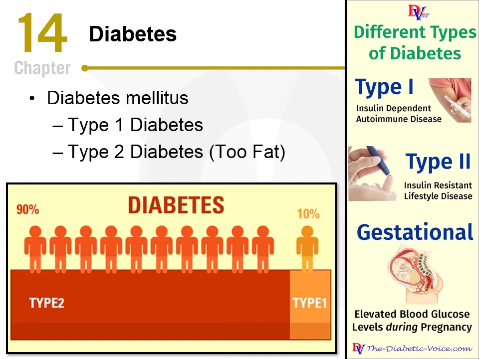
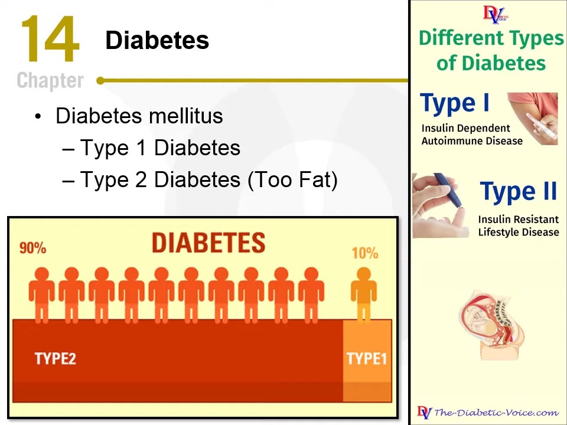
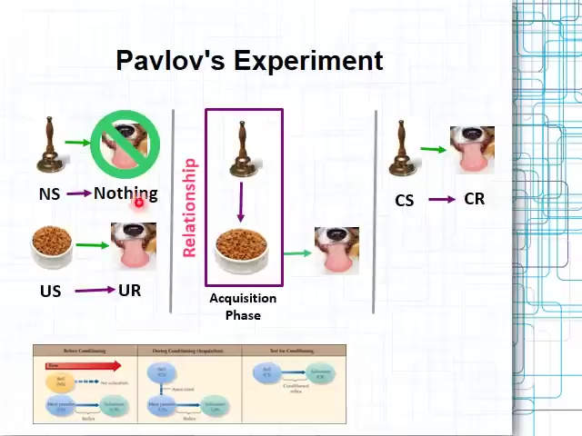

# Slide–Narration Relation Annotation (SNRA) Manual

## Contents

- [1. Purpose of this annotation](#sec-1)
- [2. Overview of this annotation](#sec-2)
  - [2.1 Information shown](#sec-2-1)
  - [2.2 Summary of the work](#sec-2-2)
- [3. Detailed instructions](#sec-3)
  - [3.1 Annotation workflow](#sec-3-1)
  - [3.2 Labels and required entries](#sec-3-2)
    - [3.2.1 Content shown on the slide](#sec-3-2-1)
    - [3.2.2 Implicit Lecture Content](#sec-3-2-2)
    - [3.2.3 Metadiscourse](#sec-3-2-3)
    - [3.2.4 Unrelated Content](#sec-3-2-4)
    - [3.2.5 Invalid NU](#sec-3-2-5)
  - [3.3 When the basis for a judgment is problematic](#sec-3-3)
  - [3.4 Transcription errors](#sec-3-4)
- [4. Worked examples](#sec-4)
  - [4.1 Diabetes slide](#sec-4-1)
  - [4.2 An NU that mixes a figure explanation with added information](#sec-4-2)

<a id="sec-1"></a>

## 1. Purpose of this annotation

Lecture slides usually present a concise outline. A lecturer may read or paraphrase the slide text, explain figures, add information that helps the audience understand the topic, and manage the lecture. The lecturer may also mention content unrelated to the current slide.

This annotation identifies how the lecturer's speech relates to slide content. The resulting data will support the analysis of **Implicit Lecture Content (ILC: information not directly shown on the current slide that helps the audience understand a topic on that slide)** and research on lecture-narration generation that adds information to support understanding.

<a id="sec-2"></a>

## 2. Overview of this annotation

<a id="sec-2-1"></a>

### 2.1 Information shown

Each **slide entry** in the lecture input file contains these three items:

1. the current slide image;
2. the full narration transcript segment associated with that slide; and
3. the list of NUs (Narration Units) extracted from that narration.

Each lecture file also gives the URL of the original lecture video (`video_url`). You may refer to it when needed ([3.4](#sec-3-4)).

**Example: `example` (source lecture `slide_index: 11`)**



Example slide image

**Original narration for this slide (beginning and end; the middle is omitted with “…”):**

> when it comes to diabetes most of us know there are two types type 1 type 2 … as i always like to do give you a little hints to help you remember things

**NUs (Narration Units) extracted from this narration:**

1. `example_s011_u01` — When it comes to diabetes, most of us know there are two types: type 1, type 2.
2. `example_s011_u02` — The way I always remember type 2 is that you're too fat.
3. `example_s011_u03` — And it's more than just simply being too fat, but that's what we tend to talk about.

…

An **NU (Narration Unit)** is a segment of the narration for one slide, produced by splitting that narration with an LLM. The extraction follows these principles:

- One NU is a coherent span of speech conveying one instructional point or discourse act (a question, a change of topic, etc.).
- Keep clauses that develop the same point together. Start a new NU when the lecturer moves to a distinct, independently understandable point, example, question, or discourse act.
- Stay as close as possible to the lecturer's wording and perspective. Preserve substantive meaning, qualifications, degree of certainty, and meaningful emphasis.
- Lightly correct punctuation, disfluencies, and clear transcription errors without adding information.

<a id="sec-2-2"></a>

### 2.2 Summary of the work

Refer to the slide and narration and assign a label to each NU.

**Primary labels**

| Primary label | Summary |
|---|---|
| `on_slide_textual_content` | Explains content shown on the slide that can be understood by reading its text (titles, bullet points, sentences, formulas, standard tables, etc.). |
| `on_slide_visual_content` | Explains content shown on the slide whose understanding requires visual interpretation of a figure or image (figures, graphs, images, etc.). |
| `implicit_lecture_content` | Adds information that is not directly shown on the slide but helps the audience understand its topic. |
| `metadiscourse` | Speech about the lecture's progress, the lecturer's attitude or evaluation toward what is being said, or interaction with the audience. |
| `unrelated_content` | Understandable speech that fits none of the categories above (e.g., “The weather is nice today”). |
| `invalid_nu` | An NU that cannot be understood even after checking the context. |

The primary labels can be grouped by whether the speech conveys knowledge to the audience:

| Group | Relation to the slide | Primary label |
|---|---|---|
| Conveys knowledge | Explains content shown on the slide | `on_slide_textual_content`<br>`on_slide_visual_content` |
| Conveys knowledge | Adds content not shown on the slide | `implicit_lecture_content` |
| Does not convey knowledge | Lecture progress, the lecturer's attitude, interaction with the audience | `metadiscourse` |
| Does not convey knowledge | None of the above | `unrelated_content` |
| (Content cannot be understood) | — | `invalid_nu` |

Note: Keep `invalid_nu` in the final annotation results to a minimum. Before assigning `invalid_nu`, check the context following the steps in [3.2.5](#sec-3-2-5), correct any transcription errors as described in [3.4](#sec-3-4), and then assign a label.

The work proceeds as follows:

1. For each NU, refer to the slide and narration and select the closest primary label.
2. If you select `implicit_lecture_content`, copy the part of the NU that is not written on the slide into `not_on_slide_span`, and enter one ILC category in `sublabel`. If the NU also contains a part that is not ILC, enter the primary label for that part in `remainder_label`.
3. If you select `metadiscourse`, enter one metadiscourse function in `sublabel`.
4. If you select `other` as the `sublabel`, briefly describe in `note` the category you think is needed and why.
5. If the NU contains a transcription error that you can correct, you may record the correction in `note` in the specified format (optional; [3.4](#sec-3-4)).

In this manual, the category entered in `label` is called the primary label, the category entered in `sublabel` is called the sublabel, and the items listed under each sublabel are called subtypes. Subtypes are not recorded.

[3.1](#sec-3-1) lists the required entries, and [3.2](#sec-3-2) explains each label.

<a id="sec-3"></a>

## 3. Detailed instructions

<a id="sec-3-1"></a>

### 3.1 Annotation workflow

First make sure you understand what each NU says. Then **select the closest primary label.** You do not need to check the primary labels in order from the top. When deciding, focus on why the lecturer is saying this (the main point or function of the utterance).

Use the following as a guide:

- Does the NU explain content shown on the slide, as part of the flow of the lecture? → `on_slide_textual_content` or `on_slide_visual_content` ([3.2.1](#sec-3-2-1))
- Does the NU add information that is not shown on the slide but helps the audience understand the topic? → `implicit_lecture_content` ([3.2.2](#sec-3-2-2))
- Is the NU about the structure or progress of the lecture, the lecturer's attitude or evaluation, or interaction with the audience? → `metadiscourse` ([3.2.3](#sec-3-2-3))
- Is the NU understandable but none of the above applies? → `unrelated_content` ([3.2.4](#sec-3-2-4))
- Does the NU itself remain impossible to understand even after checking the context? → `invalid_nu` ([3.2.5](#sec-3-2-5))

**When an NU mixes ILC with other content**

If one NU contains both added information that is not written on the slide (ILC) and other content, give priority to the added information and select `implicit_lecture_content` as the primary label. Then copy the added part into `not_on_slide_span`, and enter the primary label of the remaining part (one of `on_slide_textual_content`, `on_slide_visual_content`, `metadiscourse`, or `unrelated_content`) in `remainder_label` (e.g., [u03 in 4.1](#ex-4-1-u03), [u02 in 4.2](#ex-4-2-u02)). If the entire NU is added information, leave `remainder_label` empty (`""`) (e.g., [u07 in 4.1](#ex-4-1-u07)).

To decide whether a part counts as added information, ask **whether deleting that part would remove content that the audience receives.** If content such as an example, explanation, qualification, or background would be lost, treat it as added information (ILC). Do not count changes in wording only, such as paraphrases, repetitions, or disfluencies.

If the basis for a judgment is problematic, for example because an image is unreadable, the slide and narration do not match, or the NU differs in meaning from the narration, follow [3.3](#sec-3-3).

**Required entries**

| Primary label | Additional entry |
|---|---|
| `on_slide_textual_content` | None |
| `on_slide_visual_content` | None |
| `implicit_lecture_content` | `not_on_slide_span` (exact excerpt from the NU) + one `sublabel` (ILC category) + `remainder_label` (if the NU has a part that is not ILC) |
| `metadiscourse` | One `sublabel` (metadiscourse function) |
| `unrelated_content` | None |
| `invalid_nu` | None |

For any NU, you may also fill in `note` when needed (comments or transcription corrections).

<a id="sec-3-2"></a>

### 3.2 Labels and required entries

Assign one of the following primary labels to each NU.

<a id="sec-3-2-1"></a>

#### 3.2.1 `on_slide_textual_content` / `on_slide_visual_content` — Content shown on the slide

Use these labels when the NU explains content shown on the slide to the audience, as part of the flow of the lecture. This includes paraphrases that preserve the meaning.

**How to decide**

- Decide by **whether the main point of the utterance is to explain content written on the slide**, not by whether words in the NU appear on the slide. If an utterance only mentions a word on the slide without explaining its content (e.g., an utterance that just names a word as the next topic), consider `metadiscourse` or another label.
- This annotation assumes that the lecture proceeds through the slide content in order. The information on a slide is explained in some order, such as top to bottom or left to right. These labels are for utterances that, in this flow, **newly explain slide content that has not yet been explained**.
- An utterance that restates content already explained as key points is `metadiscourse` with `organization_management` (subtype: Summarizing).
- Even if reference material (a video, URL, textbook page, etc.) is listed on the slide, an utterance that directs the audience to look at it does not convey knowledge about the topic, so it is `metadiscourse` with `audience_interaction` (subtype: Attention directing).

**Distinguishing `on_slide_textual_content` from `on_slide_visual_content`**

The two labels are distinguished by **whether understanding the NU's content requires visual interpretation.**

- If the content can be understood by reading the text on the slide (transcribing the text would be enough), select `on_slide_textual_content`.
- If the content requires looking at the structure of a figure or the content of an image, select `on_slide_visual_content`.

The table below gives guidance for each type of slide element.

| Element | Treatment |
|---|---|
| Titles, bullet points, sentences, formulas (including handwritten ones) | `on_slide_textual_content` |
| Tables | Treat standard tables made up of text and numbers as `on_slide_textual_content`. If a table requires understanding an image, treat it as `on_slide_visual_content`. |
| Figures, flowcharts, graphs, images, etc. | `on_slide_textual_content` if the core information is conveyed by text and can be understood by reading it; `on_slide_visual_content` if understanding the structure of the figure or the image is required |

If one NU refers to several elements, choose according to the element the NU mainly explains.

For an example in which the judgment for the same NU changes depending on whether an image on the slide has text, see [u05 in 4.1](#ex-4-1-u05) (including the “Reference” part).

**Deciding between `on_slide_visual_content` and `implicit_lecture_content`**

In principle, decide as follows for NUs related to an image on the slide:

- If the image covers almost all of the NU's content, select `on_slide_visual_content`.
- If you judge that the NU contains content not represented in the image, select `implicit_lecture_content`. If part of the NU explains the image, set `remainder_label` to `on_slide_visual_content` (see [u02 in 4.2](#ex-4-2-u02)).

For difficult cases, this leaves room for the annotator's interpretation.

<a id="sec-3-2-2"></a>

#### 3.2.2 `implicit_lecture_content` — Implicit Lecture Content

Use this label when the NU **adds information that helps the audience understand a topic on the slide**, and that information is not directly shown on the current slide. Also use this label when only part of the NU is added information ([3.1](#sec-3-1)). For examples, see [u03 in 4.1](#ex-4-1-u03), [u07 in 4.1](#ex-4-1-u07), and [u02 in 4.2](#ex-4-2-u02).

**Also record:**

1. `not_on_slide_span`: the part of the NU that you judge is not written on the slide. Copy it exactly from the NU's `text` (do not paraphrase or summarize).
   - Copy it in units of phrases or clauses, as short as possible. You may include elements attached to it, such as articles, commas, and periods (strict precision is not required).
   - If the relevant content appears in separate places, copy the shortest continuous span that includes all of them.
   - If the entire NU is not written on the slide, copy the entire NU.
2. `sublabel`: the one ILC category that best describes the function of the added information. If none of the five categories fits, select `other` and briefly describe in `note` the category you think is needed and why.
3. `remainder_label`: the primary label that applies to the part of the NU outside `not_on_slide_span` (one of `on_slide_textual_content`, `on_slide_visual_content`, `metadiscourse`, or `unrelated_content`). If the entire NU is added information, leave it empty (`""`).

##### Overview of ILC categories

The table lists the five ILC categories (sublabels) and their subtypes.

**Enter one ILC category in `sublabel` and copy the part not written on the slide into `not_on_slide_span`.** Subtypes are for reference only and are not recorded.

| Category | Definition | Included subtypes |
| --- | --- | --- |
| Concept clarification<br>`concept_clarification` | Adds information that makes a term or concept easier to understand. | Definition<br>Attribute<br>Elaboration<br>Example<br>Analogy<br>Misconception correction |
| Explanation and reasoning<br>`explanation_reasoning` | Explains why or how something occurs, or what a result means. | Cause<br>Reason / Rationale<br>Mechanism<br>Process<br>Result / Consequence<br>Implication<br>Interpretation |
| Contextual knowledge<br>`contextual_knowledge` | Adds background or external knowledge that helps explain the current topic. | Background<br>Historical development<br>Evidence<br>Source / Attribution<br>Application / Use case |
| Qualification and relation<br>`qualification_relation` | Specifies the conditions, assumptions, relations, or limitations of a claim or method. | Condition<br>Assumption<br>Prerequisite<br>Comparison<br>Contrast<br>Limitation / Caveat<br>Exception |
| Method and action<br>`method_action` | Explains how a method is performed or how a problem can be solved. | Method / Approach<br>Procedure / Step<br>Practical strategy |
| Other (`other`) | The added content or function cannot be represented by the listed categories. | Free-text description |

##### Concept clarification — `concept_clarification`

What to look for: Ask what the audience learns about the meaning or characteristics of a concept. A definition, added detail, or concrete case belongs here when its main purpose is to make that concept easier to understand.

| Subtype | Detailed description |
|---|---|
| Definition | States what a term means. |
| Attribute | Describes a feature of the concept or object. |
| Elaboration | Develops a brief description with further detail. |
| Example | Gives a specific case of the concept. |
| Analogy | Explains a concept through a familiar comparison. |
| Misconception correction | Clarifies an incorrect understanding of a concept. |

##### Explanation and reasoning — `explanation_reasoning`

What to look for: Does the NU explain why or how something happens, or what a result means? This includes a cause, rationale, mechanism, consequence, or interpretation. Distinguish an NU that only states a result from one that explains why it occurred or what follows from it.

| Subtype | Detailed description |
|---|---|
| Cause | Identifies what produces an event or outcome. |
| Reason / Rationale | Explains why a claim, choice, or conclusion is justified. |
| Mechanism | Explains how interacting elements produce an outcome. |
| Process | Describes how a phenomenon unfolds over time. |
| Result / Consequence | Describes what follows from an event or action. |
| Implication | States what further conclusions can be drawn from a fact or result. |
| Interpretation | Explains how to understand the meaning of a result. |

##### Contextual knowledge — `contextual_knowledge`

What to look for: Look for background from outside the slide that places the topic in context or supports it. This can be historical context, a reported observation, an information source, or a setting in which an idea is used.

| Subtype | Detailed description |
|---|---|
| Background | Supplies surrounding facts needed to understand the topic. |
| Historical development | Describes how an idea or method originated, or how a situation developed. |
| Evidence | Reports observations or findings supporting a claim. |
| Source / Attribution | Identifies where information comes from or who proposed it. |
| Application / Use case | Describes where or for what purpose an idea or method is used. |

##### Qualification and relation — `qualification_relation`

What to look for: Focus on how the added information clarifies the scope of a claim or method, or its relationship to other matters. It may state when a claim applies, what must be assumed, how two options compare, or where a generalization has limits.

| Subtype | Detailed description |
|---|---|
| Condition | States when a claim or method applies. |
| Assumption | States what is taken as given in an explanation. |
| Prerequisite | States what must be available or satisfied beforehand. |
| Comparison | Relates objects along a shared criterion. |
| Contrast | Highlights a difference between objects or approaches. |
| Limitation / Caveat | Identifies a drawback or restriction in interpretation or use. |
| Exception | Identifies a case outside a stated generalization. |

##### Method and action — `method_action`

What to look for: Ask what someone would actually do to carry out a method or solve a problem. The added information may describe an overall approach, ordered actions, or a practical adjustment. If the NU describes how a natural or cognitive process unfolds, check whether `explanation_reasoning` applies instead.

| Subtype | Detailed description |
|---|---|
| Method / Approach | Describes a way of addressing a problem or objective. |
| Procedure / Step | Specifies actions and their order in carrying out a method. |
| Practical strategy | Describes a practical way to handle a situation or carry out an activity more effectively. |

<a id="sec-3-2-3"></a>

#### 3.2.3 `metadiscourse` — Metadiscourse

Use this label when the NU's main purpose is to indicate the lecture's structure or progression, express the lecturer's attitude or evaluation toward what is being said, or address the audience. This label also includes utterances such as the following:

- An utterance that restates content already explained as key points (`organization_management`, subtype: Summarizing)
- An utterance that mentions a word on the slide while introducing the topic to be discussed next (`organization_management`, subtype: Topic introduction)
- An utterance that directs the audience to reference material listed on the slide (a video, URL, etc.) (`audience_interaction`, subtype: Attention directing)

**Also record:** one metadiscourse function in `sublabel`.

##### Overview of metadiscourse functions

The table lists the three metadiscourse functions (sublabels) and their subtypes. The rightmost column explains each subtype. Enter one function category in `sublabel`; subtypes are not recorded.

| Category | Definition | Included subtypes | Detailed description |
|---|---|---|---|
| Discourse organization<br>`organization_management` | Organizes the structure, sequence, transitions, or progress of the lecture or presentation. | Opening<br>Closing<br>Topic introduction<br>Goal announcement<br>Sequencing<br>Transition<br>Previewing<br>Reviewing<br>Summarizing<br>Concluding<br>Endophoric reference<br>Aside<br>Returning to topic<br>Task / Schedule management<br>Time management | Opening: Marks the start of the lecture or presentation.<br>Closing: Marks the end of the lecture or presentation.<br>Topic introduction: Introduces the topic to be discussed.<br>Goal announcement: States the purpose of the lecture or a section.<br>Sequencing: Organizes the order in which points are presented.<br>Transition: Moves from one point or section to another.<br>Previewing: Indicates what will be discussed later.<br>Reviewing: Directs attention back to material already covered.<br>Summarizing: Signals a recap of the discussion.<br>Concluding: Signals the completion of a topic or section.<br>Endophoric reference: Points to an earlier or later part of the lecture or materials.<br>Aside: Signals a temporary departure from the main discussion.<br>Returning to topic: Signals a return to the main discussion.<br>Task / Schedule management: Communicates assignments or scheduling information.<br>Time management: Adjusts the lecture to the available time. |
| Speaker stance<br>`speaker_stance` | Expresses the speaker's certainty, attitude, evaluation, or commitment toward the content. | Hedge / Uncertainty<br>Booster / Certainty<br>Attitude / Evaluation<br>Importance marking<br>Difficulty marking<br>Self-positioning<br>Limiting commitment | Hedge / Uncertainty: Expresses uncertainty or presents a position cautiously.<br>Booster / Certainty: Expresses strong confidence or emphasizes a claim.<br>Attitude / Evaluation: Expresses an attitude or evaluative judgment.<br>Importance marking: Marks a point as important.<br>Difficulty marking: Comments on how easy or difficult a point is.<br>Self-positioning: Indicates the perspective or role from which the speaker is speaking.<br>Limiting commitment: Indicates how far the speaker is prepared to commit to a claim. |
| Audience interaction<br>`audience_interaction` | Addresses the audience, guides attention, checks understanding, or encourages participation. | Direct address<br>Attention directing<br>Comprehension check<br>Channel check<br>Question / Invitation<br>Directive / Request<br>Shared knowledge<br>Anticipating response<br>Inclusive reference<br>Q&A management<br>Greeting / Thanks | Direct address: Addresses the audience explicitly.<br>Attention directing: Directs attention to a point or part of the material.<br>Comprehension check: Checks whether the audience understands.<br>Channel check: Checks whether the audience can hear or see the presentation.<br>Question / Invitation: Asks for an audience response or invites participation.<br>Directive / Request: Requests an action from the audience.<br>Shared knowledge: Appeals to knowledge assumed to be shared with the audience.<br>Anticipating response: Anticipates a likely question, concern, or reaction.<br>Inclusive reference: Uses inclusive wording to involve the audience.<br>Q&A management: Organizes questions and responses from the audience.<br>Greeting / Thanks: Greets or thanks the audience. |
| Other (`other`) | The function of the NU does not fit any of the listed categories. | Free-text description | Briefly describe in `note` the category you think is needed and why. |

<a id="sec-3-2-4"></a>

#### 3.2.4 `unrelated_content` — Unrelated Content

Use this label for an understandable NU that does not convey knowledge to the audience and is not metadiscourse (e.g., “The weather is nice today”).

**Additional entry:** none.

<a id="sec-3-2-5"></a>

#### 3.2.5 `invalid_nu` — Invalid NU

Use this label when it is impossible to understand what the NU itself says, even after checking the context (e.g., the utterance is cut off). Interpret words such as “this”, “that”, or “it” from context; their presence alone is not a reason to choose this label.

Note: If the NU contains a transcription error, correct it and then assign a label as usual ([3.4](#sec-3-4)).

Check the context step by step, starting from the narrowest range, with the aim of keeping `invalid_nu` to a minimum. First check the narration and NUs of the same slide. If the NU is still unclear, check the adjacent slides and their NUs. If it is still unclear, check the audio of the original lecture video.

**Additional entry:** none.

<a id="sec-3-3"></a>

### 3.3 When the basis for a judgment is problematic

If the basis for a judgment is problematic, for example because an image is unreadable, the slide and narration do not match, or the NU differs in meaning from the narration, leave `label` empty (`""`), describe the affected passage and the reason in `note`, and hold the judgment.

If part of an image is unclear, use the narration to infer whether that part is what the lecturer is explaining.

- If you infer that the unclear part is not being explained (e.g., a figure that the lecture does not mention), you may assign a label as usual based on your inference, even without certainty. You do not need to write anything in `note`.
- Only when a figure, table, image, or similar element that is the main subject of the explanation is too unclear to judge, leave `label` empty and describe the affected passage and the reason in `note`.

<a id="sec-3-4"></a>

### 3.4 Transcription errors

The narration and NUs are based on automatic transcription and may contain errors.

- If you notice an error, you may check the original lecture video (`video_url`) and record the correction in `note`.
- Record corrections in `note` in the following format:
  - Format: `{{FIX: incorrect text => correct text}}`
  - Copy the incorrect text exactly from the NU's `text` (do not change capitalization or symbols).
  - If one NU has several errors, write several `{{FIX: … => …}}` entries.
  - You may write other comments freely outside `{{ }}`.
  - Example: `{{FIX: you've => think of}}`
- If you correct an error, base your label on the corrected content. The presence of a transcription error alone is not a reason to choose `invalid_nu`.

<a id="sec-4"></a>

## 4. Worked examples

This section shows worked examples. Each example shows the slide image at the upper left and the original narration at the upper right (split by NU, with the NU being judged in bold). Below them are the NU being judged, the entry, and the reasons for the judgment. For examples with a sublabel, the reasons also give the subtype used as a reference (subtypes are not recorded).

<a id="sec-4-1"></a>

### 4.1 Diabetes slide

These are the nine NUs of the slide in `lectures/example.json` (`slide_index: 11`).

<a id="ex-4-1-u01"></a>

#### u01 in 4.1

**What this example shows:** An NU explaining text elements on the slide

<table width="100%">
<tr>
<td width="50%" valign="top"></td>
<td width="50%" valign="top"><b>Original narration</b> (split by NU; the NU being judged is in bold)<br><br>
<b>u01: when it comes to diabetes most of us know there are two types type 1 type 2</b><br>
u02: the way i always remember type 2 is that you're too fat<br>
u03: and it's more than just simply being too fat but that's what we tend to talk about and<br>
u04: as you can see in the chart there's a lot more type 2 diabetes than there is type 1<br>
u05: now there is a third type of diabetes which is basically women who are pregnant who get elevated glucose levels during pregnancy<br>
u06: but for most of us we tend to you've only type 1 and type 2<br>
u07: those of you who are going into the allied health fields you'll might even discuss up to five different types of diabetes<br>
u08: but for us for this class type 1 type 2 and remember type 2 is because you're too fat<br>
u09: as i always like to do give you a little hints to help you remember things
</td>
</tr>
</table>

**NU being judged:** `example_s011_u01`

> When it comes to diabetes, most of us know there are two types: type 1, type 2.

**Entry:**

```json
"example_s011_u01": {
  "label": "on_slide_textual_content"
}
```

**Reasons:**

- This NU says that there are two types of diabetes, type 1 and type 2.
- It explains, for the first time on this slide, the content shown in the bullet points (Type 1 Diabetes, Type 2 Diabetes). The opening “most of us know” only leads into the point; the main point of the utterance is to explain the two types ([3.2.1](#sec-3-2-1)).
- The content can be understood by reading the bullet points, so the label is `on_slide_textual_content`.

<a id="ex-4-1-u02"></a>

#### u02 in 4.1

**What this example shows:** An NU explaining text elements on the slide

<table width="100%">
<tr>
<td width="50%" valign="top"></td>
<td width="50%" valign="top"><b>Original narration</b> (split by NU; the NU being judged is in bold)<br><br>
u01: when it comes to diabetes most of us know there are two types type 1 type 2<br>
<b>u02: the way i always remember type 2 is that you're too fat</b><br>
u03: and it's more than just simply being too fat but that's what we tend to talk about and<br>
u04: as you can see in the chart there's a lot more type 2 diabetes than there is type 1<br>
u05: now there is a third type of diabetes which is basically women who are pregnant who get elevated glucose levels during pregnancy<br>
u06: but for most of us we tend to you've only type 1 and type 2<br>
u07: those of you who are going into the allied health fields you'll might even discuss up to five different types of diabetes<br>
u08: but for us for this class type 1 type 2 and remember type 2 is because you're too fat<br>
u09: as i always like to do give you a little hints to help you remember things
</td>
</tr>
</table>

**NU being judged:** `example_s011_u02`

> The way I always remember type 2 is that you're too fat.

**Entry:**

```json
"example_s011_u02": {
  "label": "on_slide_textual_content"
}
```

**Reasons:**

- This NU says that the lecturer remembers type 2 as “too fat.”
- It explains, for the first time, what “(Too Fat)” in the bullet point “Type 2 Diabetes (Too Fat)” stands for. Although it is phrased as the lecturer's own way of remembering (“The way I always remember”), the content it conveys is the “Too Fat” written on the slide.
- The content can be understood by reading the bullet points, so the label is `on_slide_textual_content`.

<a id="ex-4-1-u03"></a>

#### u03 in 4.1

**What this example shows:** An NU mixing ILC with metadiscourse

<table width="100%">
<tr>
<td width="50%" valign="top"></td>
<td width="50%" valign="top"><b>Original narration</b> (split by NU; the NU being judged is in bold)<br><br>
u01: when it comes to diabetes most of us know there are two types type 1 type 2<br>
u02: the way i always remember type 2 is that you're too fat<br>
<b>u03: and it's more than just simply being too fat but that's what we tend to talk about and</b><br>
u04: as you can see in the chart there's a lot more type 2 diabetes than there is type 1<br>
u05: now there is a third type of diabetes which is basically women who are pregnant who get elevated glucose levels during pregnancy<br>
u06: but for most of us we tend to you've only type 1 and type 2<br>
u07: those of you who are going into the allied health fields you'll might even discuss up to five different types of diabetes<br>
u08: but for us for this class type 1 type 2 and remember type 2 is because you're too fat<br>
u09: as i always like to do give you a little hints to help you remember things
</td>
</tr>
</table>

**NU being judged:** `example_s011_u03`

> And it's more than just simply being too fat, but that's what we tend to talk about.

**Entry:**

```json
"example_s011_u03": {
  "label": "implicit_lecture_content",
  "sublabel": "concept_clarification",
  "not_on_slide_span": "more than just simply being too fat",
  "remainder_label": "metadiscourse"
}
```

**Reasons:**

- This NU says that (type 2 diabetes) is more than just being too fat, but that is how we usually talk about it.
- The slide only says “Too Fat”; it does not say that type 2 is more than simply being too fat. Deleting this part would remove the content that type 2 is not caused by being too fat alone, so it is added information (ILC) ([3.1](#sec-3-1)).
- `not_on_slide_span`: Following [3.2.2](#sec-3-2-2), the added part is copied as a phrase. The preceding “And it's” does not affect the meaning of the added information, so it is not included (including it would also be acceptable).
- `sublabel`: The NU corrects a misconception that the mnemonic “Too Fat” can easily cause, namely that type 2 diabetes is caused only by being too fat, so it is `concept_clarification` (subtype: Misconception correction).
- `remainder_label`: The core of the remaining part, “but that's what we tend to talk about,” is the lecturer commenting on how people talk (“too fat” is just how we usually put it). It does not newly explain slide content or convey new knowledge, so it is `metadiscourse`.

<a id="ex-4-1-u04"></a>

#### u04 in 4.1

**What this example shows:** An NU explaining a figure that requires visual interpretation

<table width="100%">
<tr>
<td width="50%" valign="top"></td>
<td width="50%" valign="top"><b>Original narration</b> (split by NU; the NU being judged is in bold)<br><br>
u01: when it comes to diabetes most of us know there are two types type 1 type 2<br>
u02: the way i always remember type 2 is that you're too fat<br>
u03: and it's more than just simply being too fat but that's what we tend to talk about and<br>
<b>u04: as you can see in the chart there's a lot more type 2 diabetes than there is type 1</b><br>
u05: now there is a third type of diabetes which is basically women who are pregnant who get elevated glucose levels during pregnancy<br>
u06: but for most of us we tend to you've only type 1 and type 2<br>
u07: those of you who are going into the allied health fields you'll might even discuss up to five different types of diabetes<br>
u08: but for us for this class type 1 type 2 and remember type 2 is because you're too fat<br>
u09: as i always like to do give you a little hints to help you remember things
</td>
</tr>
</table>

**NU being judged:** `example_s011_u04`

> As you can see in the chart, there's a lot more type 2 diabetes than there is type 1.

**Entry:**

```json
"example_s011_u04": {
  "label": "on_slide_visual_content"
}
```

**Reasons:**

- This NU says that, as the chart shows, type 2 diabetes is much more common than type 1.
- The phrase “As you can see in the chart” shows that the lecturer is pointing to the chart at the lower left of the slide.
- The chart also contains text such as “90%”, “10%”, “TYPE2”, and “TYPE1”, but it shows the proportions of the two types through the number of human figures and the length of the bars. The core information that type 2 is much more common lies in the structure of the figure. Understanding it requires visual interpretation of the chart, so the label is `on_slide_visual_content` ([3.2.1](#sec-3-2-1)).

<a id="ex-4-1-u05"></a>

#### u05 in 4.1

**What this example shows:** An NU explaining a figure that contains both an image and text

<table width="100%">
<tr>
<td width="50%" valign="top"></td>
<td width="50%" valign="top"><b>Original narration</b> (split by NU; the NU being judged is in bold)<br><br>
u01: when it comes to diabetes most of us know there are two types type 1 type 2<br>
u02: the way i always remember type 2 is that you're too fat<br>
u03: and it's more than just simply being too fat but that's what we tend to talk about and<br>
u04: as you can see in the chart there's a lot more type 2 diabetes than there is type 1<br>
<b>u05: now there is a third type of diabetes which is basically women who are pregnant who get elevated glucose levels during pregnancy</b><br>
u06: but for most of us we tend to you've only type 1 and type 2<br>
u07: those of you who are going into the allied health fields you'll might even discuss up to five different types of diabetes<br>
u08: but for us for this class type 1 type 2 and remember type 2 is because you're too fat<br>
u09: as i always like to do give you a little hints to help you remember things
</td>
</tr>
</table>

**NU being judged:** `example_s011_u05`

> Now, there is a third type of diabetes, which is basically women who are pregnant who get elevated glucose levels during pregnancy.

**Entry:**

```json
"example_s011_u05": {
  "label": "on_slide_textual_content"
}
```

**Reasons:**

- This NU says that there is a third type of diabetes, in which pregnant women have elevated glucose levels during pregnancy.
- The bullet points on the left list only type 1 and type 2; the third type is shown only in the figure on the right side of the slide.
- The figure on the right includes an image of a pregnant woman, but the third type is also shown in text: “Gestational” and “Elevated Blood Glucose Levels during Pregnancy.” The NU's content can be understood by reading this text; there is no need to interpret the image. The label is therefore `on_slide_textual_content` ([3.2.1](#sec-3-2-1)).
- For reference, the treatment when the figure on the right has no text is shown below.

**Reference: if the figure on the right had no text such as “Gestational”**

To illustrate the difference between `on_slide_textual_content` and `on_slide_visual_content`, the original slide has been edited: the text “Gestational” and “Elevated Blood Glucose Levels during Pregnancy” has been removed from the lower part of the figure on the right, leaving only the figure of the pregnant woman (this is not a real slide).



For this slide, the entry for u05 would be:

```json
"example_s011_u05": {
  "label": "implicit_lecture_content",
  "sublabel": "concept_clarification",
  "not_on_slide_span": "who get elevated glucose levels during pregnancy.",
  "remainder_label": "on_slide_visual_content"
}
```

- The first half, that there is a third type and that it concerns pregnant women, is not shown in text and has to be understood from the figure of the pregnant woman. This part is therefore `on_slide_visual_content`, and `remainder_label` is `on_slide_visual_content`.
- On the other hand, the point that glucose levels rise during pregnancy is not depicted in the figure. Because the NU contains content not represented in the image, the primary label is `implicit_lecture_content` ([3.2.1](#sec-3-2-1)).
- `not_on_slide_span`: Following [3.2.2](#sec-3-2-2), the clause that is added information (“who get elevated glucose levels during pregnancy”) is copied, including the final period.
- `sublabel`: The NU explains what condition the third type is, which cannot be understood from the figure alone, so it is `concept_clarification` (subtype: Attribute).
- As this shows, the judgment for the same NU can change depending on whether the slide shows the content in text or only in an image.

<a id="ex-4-1-u06"></a>

#### u06 in 4.1

**What this example shows:** An NU with a transcription error; metadiscourse

<table width="100%">
<tr>
<td width="50%" valign="top"></td>
<td width="50%" valign="top"><b>Original narration</b> (split by NU; the NU being judged is in bold)<br><br>
u01: when it comes to diabetes most of us know there are two types type 1 type 2<br>
u02: the way i always remember type 2 is that you're too fat<br>
u03: and it's more than just simply being too fat but that's what we tend to talk about and<br>
u04: as you can see in the chart there's a lot more type 2 diabetes than there is type 1<br>
u05: now there is a third type of diabetes which is basically women who are pregnant who get elevated glucose levels during pregnancy<br>
<b>u06: but for most of us we tend to you've only type 1 and type 2</b><br>
u07: those of you who are going into the allied health fields you'll might even discuss up to five different types of diabetes<br>
u08: but for us for this class type 1 type 2 and remember type 2 is because you're too fat<br>
u09: as i always like to do give you a little hints to help you remember things
</td>
</tr>
</table>

**NU being judged:** `example_s011_u06`

> But for most of us, we tend to you've only type 1 and type 2.

**Entry:**

```json
"example_s011_u06": {
  "label": "metadiscourse",
  "sublabel": "audience_interaction",
  "note": "{{FIX: you've => think of}}"
}
```

**Reasons:**

- “you've” is a transcription error; in the original lecture video the lecturer says “think of.” The correction is recorded in `note` in the format of [3.4](#sec-3-4), and the label is decided based on the corrected sentence.
- The corrected sentence means that most of us tend to think of only type 1 and type 2 when we think of diabetes. Type 1 and type 2 are written on the slide, but they were already explained in u01, and this utterance does not newly explain them. It also does not convey new knowledge to the audience, so it is neither `on_slide_textual_content` nor `implicit_lecture_content`.
- The utterance refers to a common understanding shared by the lecturer and the audience, to set up the contrast with the next NU, u07 (up to five types in the allied health fields). It is therefore `metadiscourse` with `audience_interaction` (subtype: Shared knowledge).

<a id="ex-4-1-u07"></a>

#### u07 in 4.1

**What this example shows:** An NU that is entirely added information

<table width="100%">
<tr>
<td width="50%" valign="top"></td>
<td width="50%" valign="top"><b>Original narration</b> (split by NU; the NU being judged is in bold)<br><br>
u01: when it comes to diabetes most of us know there are two types type 1 type 2<br>
u02: the way i always remember type 2 is that you're too fat<br>
u03: and it's more than just simply being too fat but that's what we tend to talk about and<br>
u04: as you can see in the chart there's a lot more type 2 diabetes than there is type 1<br>
u05: now there is a third type of diabetes which is basically women who are pregnant who get elevated glucose levels during pregnancy<br>
u06: but for most of us we tend to you've only type 1 and type 2<br>
<b>u07: those of you who are going into the allied health fields you'll might even discuss up to five different types of diabetes</b><br>
u08: but for us for this class type 1 type 2 and remember type 2 is because you're too fat<br>
u09: as i always like to do give you a little hints to help you remember things
</td>
</tr>
</table>

**NU being judged:** `example_s011_u07`

> Those of you who are going into the allied health fields, you'll might even discuss up to five different types of diabetes.

**Entry:**

```json
"example_s011_u07": {
  "label": "implicit_lecture_content",
  "sublabel": "contextual_knowledge",
  "not_on_slide_span": "Those of you who are going into the allied health fields, you'll might even discuss up to five different types of diabetes.",
  "remainder_label": ""
}
```

**Reasons:**

- This NU says that people going into the allied health fields may deal with up to five types of diabetes.
- The slide shows only three types of diabetes and does not say that the allied health fields deal with up to five. Deleting this would remove content, so it is added information (ILC).
- `not_on_slide_span`: The entire NU is not written on the slide, so following [3.2.2](#sec-3-2-2) the entire NU is copied, including the final period and grammatical errors such as “you'll might.”
- `sublabel`: The NU places the types of diabetes covered in this class within the context of the allied health fields, outside the lecture, so it is `contextual_knowledge` (subtype: Background).
- `remainder_label`: The entire NU is added information, so it is left empty.

<a id="ex-4-1-u08"></a>

#### u08 in 4.1

**What this example shows:** An NU restating content already explained

<table width="100%">
<tr>
<td width="50%" valign="top"></td>
<td width="50%" valign="top"><b>Original narration</b> (split by NU; the NU being judged is in bold)<br><br>
u01: when it comes to diabetes most of us know there are two types type 1 type 2<br>
u02: the way i always remember type 2 is that you're too fat<br>
u03: and it's more than just simply being too fat but that's what we tend to talk about and<br>
u04: as you can see in the chart there's a lot more type 2 diabetes than there is type 1<br>
u05: now there is a third type of diabetes which is basically women who are pregnant who get elevated glucose levels during pregnancy<br>
u06: but for most of us we tend to you've only type 1 and type 2<br>
u07: those of you who are going into the allied health fields you'll might even discuss up to five different types of diabetes<br>
<b>u08: but for us for this class type 1 type 2 and remember type 2 is because you're too fat</b><br>
u09: as i always like to do give you a little hints to help you remember things
</td>
</tr>
</table>

**NU being judged:** `example_s011_u08`

> But for us, for this class, type 1, type 2, and remember type 2 is because you're too fat.

**Entry:**

```json
"example_s011_u08": {
  "label": "metadiscourse",
  "sublabel": "organization_management"
}
```

**Reasons:**

- This NU says that, for this class, the audience should remember type 1 and type 2, and that type 2 is because of being too fat.
- Type 1, type 2, and “Too Fat” are all written on the slide, but the slide content has already been covered in u01–u05. This NU does not newly explain the content; after limiting the scope with “for us, for this class,” it restates what has already been explained as the points to remember for this class ([3.2.1](#sec-3-2-1)).
- It is therefore `metadiscourse` with `organization_management` (subtype: Summarizing).

<a id="ex-4-1-u09"></a>

#### u09 in 4.1

**What this example shows:** An NU about the lecturer's way of teaching

<table width="100%">
<tr>
<td width="50%" valign="top"></td>
<td width="50%" valign="top"><b>Original narration</b> (split by NU; the NU being judged is in bold)<br><br>
u01: when it comes to diabetes most of us know there are two types type 1 type 2<br>
u02: the way i always remember type 2 is that you're too fat<br>
u03: and it's more than just simply being too fat but that's what we tend to talk about and<br>
u04: as you can see in the chart there's a lot more type 2 diabetes than there is type 1<br>
u05: now there is a third type of diabetes which is basically women who are pregnant who get elevated glucose levels during pregnancy<br>
u06: but for most of us we tend to you've only type 1 and type 2<br>
u07: those of you who are going into the allied health fields you'll might even discuss up to five different types of diabetes<br>
u08: but for us for this class type 1 type 2 and remember type 2 is because you're too fat<br>
<b>u09: as i always like to do give you a little hints to help you remember things</b>
</td>
</tr>
</table>

**NU being judged:** `example_s011_u09`

> As I always like to do, give you a little hints to help you remember things.

**Entry:**

```json
"example_s011_u09": {
  "label": "metadiscourse",
  "sublabel": "speaker_stance"
}
```

**Reasons:**

- This NU says that, as the lecturer always likes to do, they give small hints to help the audience remember things.
- This is the last NU of the slide and no new explanation follows, so it is not a topic introduction. Following the “too fat” mnemonic just before, the lecturer comments on their own way of teaching; the utterance conveys no new knowledge to the audience.
- It is therefore `metadiscourse` with `speaker_stance` (subtype: Self-positioning).

<a id="sec-4-2"></a>

### 4.2 An NU that mixes a figure explanation with added information

This is one NU from the slide in `lectures/LectureSeriesForIntrotoPsy-PSY101_1.json` (`slide_index: 6`).

<a id="ex-4-2-u02"></a>

#### u02 in 4.2

**What this example shows:** How to handle an explanation of a figure combined with added information not shown in the figure

<table width="100%">
<tr>
<td width="50%" valign="top"></td>
<td width="50%" valign="top"><b>Original narration</b> (split by NU; the NU being judged is in bold)<br><br>
u01: so this is pavan is experiment and right here you see this same chart that's in your book and we're basically going to do the same chart here but i like using pictures i find it for me a little bit more understandable<br>
<b>u02: so the first thing we're going to do is we're going to have this little bell and we're going to be ringing the bell and the dog will respond but it doesn't drool it doesn't make saliva it made twist his head it may bark but basically this neutral stimulus will lead to nothing nothing meanings it doesn't give us the response we're looking for</b><br>
u03: so now what we want to do is find this unconditioned stimulus to get this unconditioned response so we give this dog meat the dog is going to begin to drool to salivate we know that the dog doesn't have to learn that we don't have to learn that you put some good food in my mouth and i began to salivate to help the digestion process<br>
u04: well this is the first step we have to prove that this bell right now does not get the desired response our hope is that in the end will going to be able to ring the bell over here and that will get cool<br>
u05: so how do we do that well we need to build a relationship up between the bell and the food so basically we're going to present them food and ring the bell exactly at the same time and this relationship then is being built between these two things this is called the acquisition phase so we're acquiring the conditioning<br>
u06: because the food will naturally lead to drooling but in the brain of the dog within the audit tomic nervous system the food in the bell are coming the same thing the bell represents food and food represents the bell<br>
u07: if we've done well in the end i ring the bell and i get drool well this neutral stimulus has changed to a conditioned stimulus hasn't it because now i get a conditioned response<br>
u08: and that's one of the neat things about this is that a neutral stimulus will lead to nothing an unconditioned stimulus should always lead to an unconditioned response and the conditioned stimulus should always lead to a conditioned response<br>
u09: well this pattern is a preset pattern we don't have much choice with this if we're talking about classical shooting this is the pattern so we can put anything that's been classically conditioned put it into this pattern and we should see it works the same way<br>
u10: so let's talk about a five year old boy johnny johnny is in his backyard he sees a little garden snake now johnny's not afraid of the garden snake he goes up he's going to go touch it or look at it or do something with it he doesn't know so right now the snake is a neutral stimulus because he does not produce fear when he sees the snake<br>
u11: however as he goes to book a at the snake an 18-wheeler blows its horn now if you have an 18 wheeler blows a horn right behind you you're probably going to jump or have fear so the horn produces fear<br>
u12: now what happened unfortunately is that he's looking at the snake at the same time the horn is sounded so he begins to associate fear which was the response to the horn with the snake<br>
u13: and now when johnny goes in the backyard he sees snake he begins to back up a little bit his heart races a little bit always a little fear of the snake<br>
u14: now in the beginning he had no fear of the snake remember he was all over going to go play with it and touch it now he has a fear of the snake so that neutral stimulus has become the conditioned stimulus it had a change<br>
u15: now this can happen in many different ways we'll talk about some of the fun things in class where we have seen some pavlovian classically conditioned things to yourself
</td>
</tr>
</table>

**NU being judged:** `LectureSeriesForIntrotoPsy-PSY101/1_s006_u02`

> So the first thing we're going to do is we're going to have this little bell, and we're going to be ringing the bell, and the dog will respond, but it doesn't drool, it doesn't make saliva; it may twist his head, it may bark, but basically this neutral stimulus will lead to nothing. Nothing means it doesn't give us the response we're looking for.

**Entry:**

```json
"LectureSeriesForIntrotoPsy-PSY101/1_s006_u02": {
  "label": "implicit_lecture_content",
  "sublabel": "concept_clarification",
  "not_on_slide_span": "it may twist his head, it may bark, but basically this neutral stimulus will lead to nothing. Nothing means it doesn't give us the response we're looking for.",
  "remainder_label": "on_slide_visual_content"
}
```

**Reasons:**

- This NU says that when the bell rings, the dog responds but does not drool. It may tilt its head or bark, but this neutral stimulus leads to “nothing,” and “nothing” means that it does not produce the response we are looking for.
- The first half (“So the first thing ... it doesn't make saliva;”) explains the figure at the upper left of the slide. In this figure, an arrow leads from a bell to an image of a dog with a prohibition sign, and “NS → Nothing” is written below. That the dog does not drool when the bell rings is read from the arrow and the image with the prohibition sign, so understanding it requires visual interpretation of the figure.
- The second half, that the dog may tilt its head or bark and that “Nothing” means the desired response is not obtained, is not shown in the figure. The figure only says “Nothing”; the lecturer adds that some response may occur, but not the target response (drooling). Deleting this part would remove content, so it is added information (ILC), and the primary label is `implicit_lecture_content` ([3.1](#sec-3-1)).
- `not_on_slide_span`: Following [3.2.2](#sec-3-2-2), the added information is copied in units of clauses and sentences. Because it appears in two places, “it may twist his head, it may bark” and “Nothing means ...”, the shortest continuous span is copied, including “but basically this neutral stimulus will lead to nothing.” in between. The final period is included.
- `sublabel`: The NU explains what the word “Nothing” in the figure means, so it is `concept_clarification` (subtype: Definition).
- `remainder_label`: The remaining first half explains the figure, so it is `on_slide_visual_content`.
