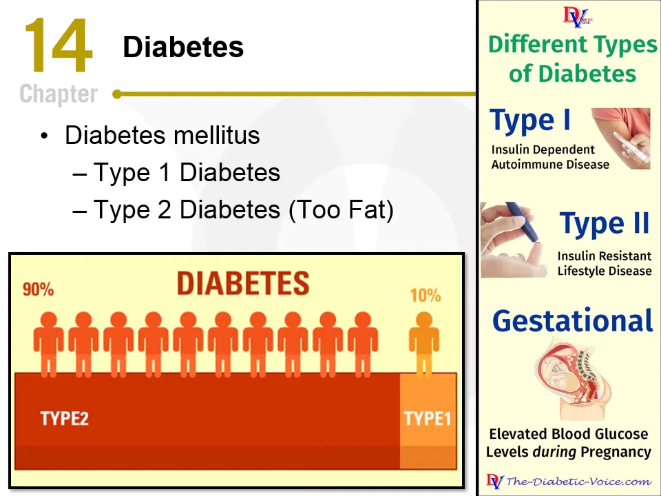
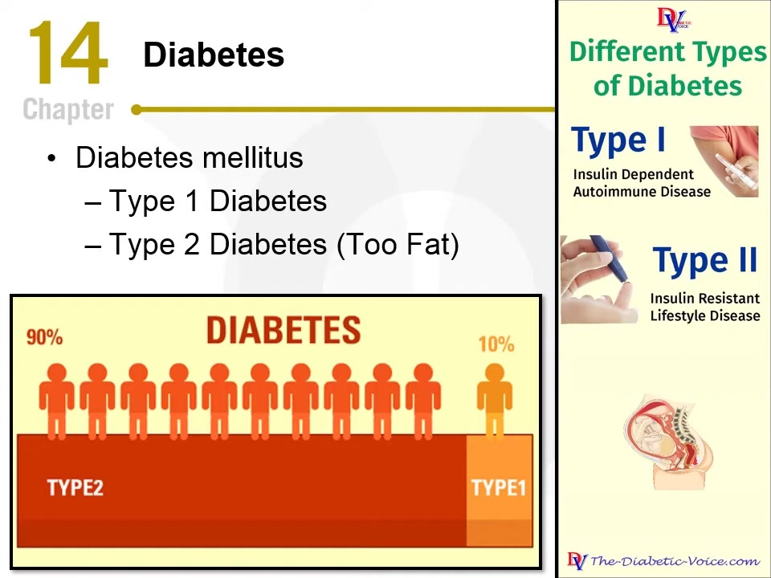
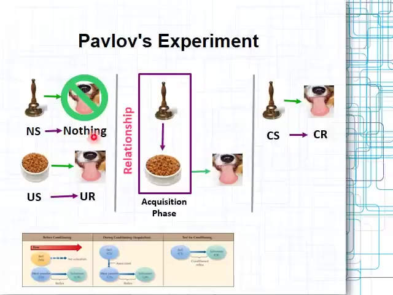

# スライド・ナレーション関係アノテーション（SNRA）マニュアル

## 目次

- [1. 本アノテーションの目的](#sec-1)
- [2. 本アノテーションの概要](#sec-2)
  - [2.1 表示される情報](#sec-2-1)
  - [2.2 作業内容の概要](#sec-2-2)
- [3. 作業内容の詳細](#sec-3)
  - [3.1 アノテーション作業の流れ](#sec-3-1)
  - [3.2 ラベルの種類と入力内容](#sec-3-2)
    - [3.2.1 スライドに示された内容](#sec-3-2-1)
    - [3.2.2 スライドに明示されない講義内容](#sec-3-2-2)
    - [3.2.3 メタ談話](#sec-3-2-3)
    - [3.2.4 無関係な内容](#sec-3-2-4)
    - [3.2.5 解釈不能な NU](#sec-3-2-5)
  - [3.3 判断の前提に問題がある場合](#sec-3-3)
  - [3.4 文字起こしの誤り](#sec-3-4)
- [4. 作業例](#sec-4)
  - [4.1 糖尿病のスライド](#sec-4-1)
  - [4.2 図の説明と補足が混在する NU](#sec-4-2)

<a id="sec-1"></a>

## 1. 本アノテーションの目的

講義で用いるスライドには、通常、内容が簡潔にまとめられている。講師はスライドの文章を読み上げたり言い換えたりするだけでなく、図表を説明し、理解に役立つ情報を補足し、講義の進行を管理する。また、現在のスライドとは関係のない内容を話すこともある。

本アノテーション作業は、講義の発話内容を対象に、スライドの内容との関係を明らかにすることを目的とする。作成したデータは、Implicit Lecture Content（ILC：現在のスライドに直接示されていないが、そのスライド上の話題の理解に役立つ情報）の分析と、理解に役立つ情報を補足する講義ナレーション生成の研究に利用する。

<a id="sec-2"></a>

## 2. 本アノテーションの概要

<a id="sec-2-1"></a>

### 2.1 表示される情報

講義の入力ファイルには、**スライド1枚ごとに**次の3項目が記載される。

1. 現在のスライド画像
2. そのスライドに対応付けられたナレーション（発話テキスト）の全文
3. そのナレーションから抽出された NU（Narration Unit）の一覧

また、講義ごとに元の講義動画の URL（`video_url`）が記載されている。必要に応じて参照してよい（[3.4](#sec-3-4)）。

**例：`example`（元講義の `slide_index: 11`）**



スライド画像の例

**対応するナレーション原文（冒頭と末尾。中間は「…」で省略）：**

> when it comes to diabetes most of us know there are two types type 1 type 2 … as i always like to do give you a little hints to help you remember things

**このナレーションから抽出された NU（Narration Unit）：**

1. `example_s011_u01` — When it comes to diabetes, most of us know there are two types: type 1, type 2.
2. `example_s011_u02` — The way I always remember type 2 is that you're too fat.
3. `example_s011_u03` — And it's more than just simply being too fat, but that's what we tend to talk about.

…

**NU（Narration Unit）** とは、スライド1枚分のナレーションを LLM で分割した発話単位である。NU の抽出には、次の方針を用いた。

- 1つの NU は、説明上の要点1つ、または談話行為（質問、話題の切り替えなど）1つを伝える、まとまりのある発話とする。
- 同じ要点について述べている部分は1つにまとめ、独立して理解できる別の要点・例・質問・談話行為に移った箇所で区切る。
- 講師の言い方と視点をできるだけ保ち、内容上の意味、限定、確信の度合い、意味のある強調を維持する。
- 句読点、言いよどみ、明らかな文字起こしの誤りは、情報を付け足さない範囲で軽く整える。

<a id="sec-2-2"></a>

### 2.2 作業内容の概要

スライドとナレーションを参照し、NU 1件ごとにラベルを付ける。

**主ラベル一覧**

| 主ラベル | 概要 |
|---|---|
| `on_slide_textual_content` | スライドに示された内容のうち、文字を読めば理解できる内容（タイトル、箇条書き、文章、数式、標準的な表など）を説明する。 |
| `on_slide_visual_content` | スライドに示された内容のうち、理解に図や画像の視覚的な理解が必要な内容（図、グラフ、画像など）を説明する。 |
| `implicit_lecture_content` | スライドに直接示されていない、話題の理解に役立つ情報を補足する。 |
| `metadiscourse` | 講義の進行、発言内容に対する講師の態度・評価、聞き手とのやり取りに関する発話。 |
| `unrelated_content` | 意味は分かるが、上記のいずれにも当てはまらない（例：「今日は天気がいいですね」）。 |
| `invalid_nu` | 文脈を確認しても内容を理解できない NU。 |

主ラベルは、その発話が聞き手に知識を伝えるものかどうかによって、次のように整理できる。

| 区分 | スライドとの関係 | 主ラベル |
|---|---|---|
| 知識を伝える発話 | スライドに示された内容を説明する | `on_slide_textual_content`<br>`on_slide_visual_content` |
| 知識を伝える発話 | スライドに示されていない内容を補足する | `implicit_lecture_content` |
| 知識を伝えない発話 | 講義の進行・講師の態度・聞き手とのやり取り | `metadiscourse` |
| 知識を伝えない発話 | 上記のいずれにも当たらない | `unrelated_content` |
| （内容を理解できない） | — | `invalid_nu` |

※ 最終的なアノテーション結果には、できるだけ `invalid_nu` が残らないようにする。`invalid_nu` を付ける前に、[3.2.5](#sec-3-2-5) の手順で文脈を確認し、文字起こしの誤りは [3.4](#sec-3-4) に従って修正したうえでラベルを付ける。

作業の手順は次のとおりである。

1. NU ごとに、スライドとナレーションを参照し、主ラベルの中から最も近いものを1つ選ぶ。
2. `implicit_lecture_content` を選んだ場合は、NU のうちスライドに書かれていない部分を `not_on_slide_span` に抜き出し、ILC分類を1つ `sublabel` に記入する。NU に ILC 以外の部分も含まれる場合は、その部分の主ラベルを `remainder_label` に記入する。
3. `metadiscourse` を選んだ場合は、メタ談話の機能分類を1つ `sublabel` に記入する。
4. `sublabel` に `other` を選んだ場合は、必要と考えた分類とその理由を `note` に簡潔に記入する。
5. NU の文字起こしに誤りがあり、修正できる場合は、修正内容を決められた形式で `note` に記入してもよい（任意。[3.4](#sec-3-4)）。

本マニュアルでは、`label` に記入する分類を「主ラベル」、`sublabel` に記入する分類を「サブラベル」、各サブラベルの説明に挙げた下位項目を「細分類」と呼ぶ。細分類は記入しない。

入力項目の一覧は [3.1](#sec-3-1)、各ラベルの説明は [3.2](#sec-3-2) に示す。

<a id="sec-3"></a>

## 3. 作業内容の詳細

<a id="sec-3-1"></a>

### 3.1 アノテーション作業の流れ

各 NU の意味を確認したうえで、**主ラベルの中から最も近いものを1つ選ぶ。** 主ラベルを上から順に判断する必要はない。判断の際は、講師がなぜその発話をしているのか（発話の主旨・機能）に注目する。

判断の目安は次のとおりである。

- スライドに示された内容を、講義の流れの中で説明しているか。→ `on_slide_textual_content` または `on_slide_visual_content`（[3.2.1](#sec-3-2-1)）
- スライドに示されていない、話題の理解に役立つ情報を補足しているか。→ `implicit_lecture_content`（[3.2.2](#sec-3-2-2)）
- 講義の構成・進行、講師の態度・評価、聞き手とのやり取りに関する発話か。→ `metadiscourse`（[3.2.3](#sec-3-2-3)）
- 意味は分かるが、いずれにも当てはまらないか。→ `unrelated_content`（[3.2.4](#sec-3-2-4)）
- 文脈を確認しても NU 自体の内容を理解できないか。→ `invalid_nu`（[3.2.5](#sec-3-2-5)）

**ILC とそれ以外の内容が1つの NU に混在する場合**

1つの NU に、スライドに書かれていない補足（ILC）と、それ以外の内容が混在している場合は、補足を優先して主ラベルを `implicit_lecture_content` とする。そのうえで、補足部分を `not_on_slide_span` に抜き出し、補足部分を除いた残りの部分の主ラベル（`on_slide_textual_content`、`on_slide_visual_content`、`metadiscourse`、`unrelated_content` のいずれか）を `remainder_label` に記入する（例：[4.1 の u03](#ex-4-1-u03)、[4.2 の u02](#ex-4-2-u02)）。NU 全体が補足である場合、`remainder_label` は空欄（`""`）とする（例：[4.1 の u07](#ex-4-1-u07)）。

補足とみなすかどうかは、**その部分を削除すると、聞き手が受け取る内容が失われるか**で判断する。具体例、説明、限定、背景など、内容面の情報が失われる場合は補足（ILC）とする。言い換え、繰り返し、言いよどみなど、言い回しが変わるだけのものは補足に含めない。

画像が読めない、スライドとナレーションが対応していない、NU とナレーションの意味が異なるなど、判断の前提に問題がある場合は [3.3](#sec-3-3) に従う。

**入力項目一覧**

| 主ラベル | 追加入力 |
|---|---|
| `on_slide_textual_content` | なし |
| `on_slide_visual_content` | なし |
| `implicit_lecture_content` | `not_on_slide_span`（NU からの抜き出し）＋ `sublabel`（ILC分類）1つ ＋ `remainder_label`（ILC 以外の部分がある場合） |
| `metadiscourse` | `sublabel`（機能分類）1つ |
| `unrelated_content` | なし |
| `invalid_nu` | なし |

すべての NU に共通して、必要に応じて `note`（メモや文字起こしの修正内容）を記入できる。

<a id="sec-3-2"></a>

### 3.2 ラベルの種類と入力内容

各 NU に、以下の主ラベルのいずれか1つを付ける。

<a id="sec-3-2-1"></a>

#### 3.2.1 `on_slide_textual_content` / `on_slide_visual_content` — スライドに示された内容

スライドに示された内容を、講義の流れの中で聞き手に説明している場合に選ぶ。意味を変えずに言い換えたものも含む。

**判断の考え方**

- NU に含まれる語がスライドにあるかどうかではなく、**発話の主旨がスライドに記載された内容の説明であるか**で判断する。スライド上の語に触れているだけで、その内容を説明していない発話（例：これから扱う話題として語を挙げるだけの発話）は、`metadiscourse` などを検討する。
- 本アノテーションでは、講義はスライドの内容に沿って順を追って進むと想定する。スライド上の情報は、上から下、左から右など、何らかの順序で一通り説明されていく。このラベルは、その流れの中で、**まだ説明されていないスライドの内容を新たに説明する発話**に付ける。
- すでに説明した内容を、要点としてまとめ直している発話は、`metadiscourse` の `organization_management`（細分類：要約）とする。
- 参考資料（動画、URL、教科書のページなど）がスライドに記載されていても、その資料を見るよう案内する発話は、話題に関する知識を伝えていないため、`metadiscourse` の `audience_interaction`（細分類：注目の誘導）とする。

**`on_slide_textual_content` と `on_slide_visual_content` の区別**

2つのラベルは、**NU の内容を理解するのに、視覚的な理解が必要かどうか**で区別する。

- スライド上の文字を読めば理解できる場合（文字を書き起こすだけで足りる場合）は、`on_slide_textual_content` とする。
- 図の構造や画像の内容を見て理解する必要がある場合は、`on_slide_visual_content` とする。

スライドの要素ごとの扱いの目安を、次に示す。

| 要素 | 扱い |
|---|---|
| タイトル、箇条書き、文章、数式（手書きを含む） | `on_slide_textual_content` |
| 表 | 標準的な、文字と数値で構成される表については `on_slide_textual_content` として扱う。ただし、画像の理解が必要な表があった場合は、`on_slide_visual_content` として扱う。 |
| 図、フローチャート、グラフ、画像など | 伝えている情報の中心が文字で、文字を読めば理解できる場合は `on_slide_textual_content`、図の構造や画像の理解が必要な場合は `on_slide_visual_content` |

1つの NU が複数の要素に触れている場合は、NU が主に説明している要素に応じて選ぶ。

スライド中の画像について、同じ NU でも文字の有無によって判断が変わる例は、[4.1 の u05](#ex-4-1-u05)（「参考」を含む）を参照。

**`on_slide_visual_content` と `implicit_lecture_content` の判断**

スライド中の画像に関連する NU は、原則として次のように判断する。

- 画像から NU の内容がほぼカバーされている場合は、`on_slide_visual_content` とする。
- 画像で表現されていない内容を含むと判断した場合は、`implicit_lecture_content` とする。画像の説明に当たる部分がある場合は、`remainder_label` を `on_slide_visual_content` とする（[4.2 の u02](#ex-4-2-u02) 参照）。

判断が難しい例においては、アノテーターの解釈の余地がある。

<a id="sec-3-2-2"></a>

#### 3.2.2 `implicit_lecture_content` — スライドに明示されない講義内容

現在のスライドには直接示されていないが、**そのスライド上の話題の理解に役立つ情報を補足している**場合に選ぶ。NU の一部だけが補足である場合も、このラベルを選ぶ（[3.1](#sec-3-1)）。具体例は、[4.1 の u03](#ex-4-1-u03)、[4.1 の u07](#ex-4-1-u07)、[4.2 の u02](#ex-4-2-u02) を参照。

**追加入力：**

1. `not_on_slide_span`：NU のうち、スライドに書かれていないと判断した部分。NU の `text` から該当部分をそのままコピーする（言い換えや要約はしない）。
   - できるだけ短い句・節の単位で抜き出す。冠詞やカンマ、ピリオドなど、該当部分に付属する要素は含めてよい（厳密さは求めない）。
   - 該当部分が複数箇所に分かれている場合は、それらをすべて含む最短の連続した範囲をコピーする。
   - NU 全体がスライドに書かれていない内容であれば、NU 全体をコピーする。
2. `sublabel`：補足内容が果たしている役割に最も近い ILC分類を1つ。5つの分類のいずれにも当てはまらない場合は `other` を選び、必要と考えた分類とその理由を `note` に簡潔に記入する。
3. `remainder_label`：NU のうち `not_on_slide_span` 以外の部分に当てはまる主ラベル（`on_slide_textual_content`、`on_slide_visual_content`、`metadiscourse`、`unrelated_content` のいずれか）。NU 全体が補足である場合は空欄（`""`）とする。

##### ILC分類一覧

以下に、ILC分類（サブラベル）5つと、それぞれに含まれる細分類を示す。

**ILC分類を1つ選んで `sublabel` に記入し、スライドに書かれていない部分を `not_on_slide_span` に抜き出す。** 細分類は判断の目安であり、記入は不要。

| 分類 | 定義 | 含まれる細分類 |
| --- | --- | --- |
| 概念の明確化<br>`concept_clarification` | 用語や概念の理解に役立つ情報を補足する。 | 定義・用語説明（Definition）<br>特徴・性質（Attribute）<br>詳述（Elaboration）<br>具体例・事例（Example）<br>類推・比喩（Analogy）<br>誤解の訂正（Misconception correction） |
| 説明・推論<br>`explanation_reasoning` | ある現象がなぜ・どのように生じるか、また結果が何を意味するかを説明する。 | 原因（Cause）<br>理由（Reason / Rationale）<br>仕組み（Mechanism）<br>過程（Process）<br>結果・影響（Result / Consequence）<br>含意（Implication）<br>解釈（Interpretation） |
| 背景・文脈知識<br>`contextual_knowledge` | 現在の話題の理解に役立つ外部知識や背景情報を補足する。 | 背景（Background）<br>歴史的経緯（Historical development）<br>証拠・裏付け（Evidence）<br>出典・提唱者（Source / Attribution）<br>応用・利用場面（Application / Use case） |
| 条件・関係・制約<br>`qualification_relation` | 主張や方法が成立する条件、前提、他の対象との関係、または制約を補足する。 | 条件（Condition）<br>仮定・前提（Assumption）<br>事前要件（Prerequisite）<br>比較（Comparison）<br>対照（Contrast）<br>制約・注意点（Limitation / Caveat）<br>例外（Exception） |
| 方法・実践<br>`method_action` | 方法を実施する手順や、問題を解決するための具体的な工夫を説明する。 | 方法・アプローチ（Method / Approach）<br>手順（Procedure / Step）<br>実践上の工夫（Practical strategy） |
| その他（`other`） | 既存の分類で補足内容や機能を表せない場合。 | 自由記述 |

##### 概念の明確化（Concept clarification） — `concept_clarification`

判断のポイント：用語や概念の意味・特徴について、聞き手が何を理解できるようになるかに注目する。定義、詳しい説明、具体的な事例によって概念を理解しやすくする補足が該当する。

| 細分類 | 詳しい説明 |
|---|---|
| 定義・用語説明（Definition） | 用語が何を意味するかを説明する。 |
| 特徴・性質（Attribute） | 概念や対象が持つ特徴を説明する。 |
| 詳述（Elaboration） | 簡潔な説明に、理解に必要な詳細を加える。 |
| 具体例・事例（Example） | 概念に当てはまる具体的な事例を示す。 |
| 類推・比喩（Analogy） | 身近なものにたとえて概念を説明する。 |
| 誤解の訂正（Misconception correction） | 概念について生じやすい誤解を正す。 |

##### 説明・推論（Explanation and reasoning） — `explanation_reasoning`

判断のポイント：NU が「なぜそうなるのか」「どのように生じるのか」「その結果から何が言えるのか」を説明しているかに注目する。原因、理由、仕組み、結果から導かれる意味などが該当する。結果を述べているだけの発話と、その理由や含意まで説明している発話を区別する。

| 細分類 | 詳しい説明 |
|---|---|
| 原因（Cause） | 現象や結果を生じさせる要因を示す。 |
| 理由（Reason / Rationale） | 主張、選択、結論が妥当とされる理由を示す。 |
| 仕組み（Mechanism） | 複数の要素がどのように働き合って結果が生じるかを説明する。 |
| 過程（Process） | 現象がどのような順序で進むかを説明する。 |
| 結果・影響（Result / Consequence） | ある出来事や行動によって生じる結果や影響を示す。 |
| 含意（Implication） | 事実や結果から、さらに何が言えるかを示す。 |
| 解釈（Interpretation） | 結果をどう捉えるか、その意味を説明する。 |

##### 背景・文脈知識（Contextual knowledge） — `contextual_knowledge`

判断のポイント：スライド上の話題を位置付けたり裏付けたりする周辺情報に注目する。歴史的な経緯、観察や研究で得られた事実、出典、使われる場面などが該当する。

| 細分類 | 詳しい説明 |
|---|---|
| 背景（Background） | 話題を理解するための周辺情報を示す。 |
| 歴史的経緯（Historical development） | 概念や方法が生まれた経緯、あるいは状況が変化してきた経緯を示す。 |
| 証拠・裏付け（Evidence） | 主張を裏付ける観察結果や研究上の知見を示す。 |
| 出典・提唱者（Source / Attribution） | 情報の出典や、考え方を提案した人物・組織を示す。 |
| 応用・利用場面（Application / Use case） | 概念や方法がどのような場面・目的で使われるかを示す。 |

##### 条件・関係・制約（Qualification and relation） — `qualification_relation`

判断のポイント：補足によって、主張や方法の適用範囲や他の対象との関係がどう明確になるかに注目する。成立する条件、説明の前提、他の対象との比較、利用上の制約、一般的な説明に対する例外などが該当する。

| 細分類 | 詳しい説明 |
|---|---|
| 条件（Condition） | 主張や方法が成立する条件を示す。 |
| 仮定・前提（Assumption） | 説明を進める上で、成り立つと仮定していることを示す。 |
| 事前要件（Prerequisite） | 実施や理解の前に満たしておく必要がある条件を示す。 |
| 比較（Comparison） | 共通の観点から複数の対象を比べる。 |
| 対照（Contrast） | 対象や方法の違いを際立たせる。 |
| 制約・注意点（Limitation / Caveat） | 解釈や利用に当たっての欠点や制限を示す。 |
| 例外（Exception） | 一般的な説明に当てはまらない事例を示す。 |

##### 方法・実践（Method and action） — `method_action`

判断のポイント：方法を実行したり問題を解決したりするために、何をするかに注目する。基本的な進め方、具体的な手順、状況に応じた工夫などが該当する。自然現象や認知の過程がどのように進むかを述べている場合は、「説明・推論」に当たるかを確認する。

| 細分類 | 詳しい説明 |
|---|---|
| 方法・アプローチ（Method / Approach） | 問題や目的に取り組む方法を示す。 |
| 手順（Procedure / Step） | 方法を実行する際の行動と順序を示す。 |
| 実践上の工夫（Practical strategy） | 状況に応じた対応や、作業をよりよく進めるための工夫を示す。 |

<a id="sec-3-2-3"></a>

#### 3.2.3 `metadiscourse` — メタ談話

講義の構成や進行を示すこと、発言内容に対する講師の態度や評価を示すこと、または聞き手に働きかけることを主な目的とする発話に選ぶ。次のような発話もこのラベルに含む。

- すでに説明した内容を、要点としてまとめ直す発話（`organization_management`、細分類：要約）
- スライド上の語に触れながら、これから扱う話題を導入する発話（`organization_management`、細分類：話題の導入）
- スライドに記載された参考資料（動画、URL など）を見るよう案内する発話（`audience_interaction`、細分類：注目の誘導）

**追加入力：**`sublabel` に機能分類を1つ記入する。

##### メタ談話の機能分類一覧

以下に、メタ談話の機能分類（サブラベル）3つと、それぞれに含まれる細分類を示す。右端の列で各細分類を説明している。`sublabel` に記入するのは機能分類1つであり、細分類は記入しない。

| 分類 | 定義 | 含まれる細分類 | 詳しい説明 |
|---|---|---|---|
| 談話の構成・進行<br>`organization_management` | 講義・発表の構成や順序を示し、話題の切り替えや進行を案内する。 | 導入・開始（Opening）<br>終了（Closing）<br>話題の導入（Topic introduction）<br>目的の提示（Goal announcement）<br>順序・列挙（Sequencing）<br>移行・話題転換（Transition）<br>予告（Previewing）<br>振り返り（Reviewing）<br>要約（Summarizing）<br>話題の終了（Concluding）<br>講義内の他の箇所への言及（Endophoric reference）<br>余談の明示（Aside）<br>本題への復帰（Returning to topic）<br>課題・日程管理（Task / Schedule management）<br>時間管理（Time management） | 導入・開始：講義・発表の開始を示す。<br>終了：講義・発表全体の終了を示す。<br>話題の導入：これから扱う話題を示す。<br>目的の提示：講義や各節の目的を示す。<br>順序・列挙：説明する順序を示す。<br>移行・話題転換：説明する項目や節の切り替えを示す。<br>予告：後で扱う内容を予告する。<br>振り返り：すでに扱った内容を振り返る。<br>要約：説明の要点をまとめる段階であることを示す。<br>話題の終了：1つの話題や節を締めくくる。<br>講義内の他の箇所への言及：講義や資料の、すでに扱った箇所やこれから扱う箇所に言及する。<br>余談の明示：本題から一時的に離れることを示す。<br>本題への復帰：本題に戻ることを示す。<br>課題・日程管理：課題や日程に関する連絡を行う。<br>時間管理：残り時間や時間配分に応じて進行を調整する。 |
| 話者のスタンス<br>`speaker_stance` | 発言内容について、話者がどの程度確信しているか、どのような態度や評価を示しているか、どこまで言い切るかを示す。 | 婉曲・不確実性（Hedge / Uncertainty）<br>強調・確信（Booster / Certainty）<br>態度・評価（Attitude / Evaluation）<br>重要性の提示（Importance marking）<br>難易度の提示（Difficulty marking）<br>話者自身の立場（Self-positioning）<br>断言する範囲の限定（Limiting commitment） | 婉曲・不確実性：確信の程度を控えめに示す。<br>強調・確信：強い確信を示したり、主張を強調したりする。<br>態度・評価：内容に対する態度や評価を示す。<br>重要性の提示：説明上重要な点であることを示す。<br>難易度の提示：内容の理解のしやすさや難しさを示す。<br>話者自身の立場：話者がどの立場から発言しているかを示す。<br>断言する範囲の限定：話者がどこまで言い切れるか、その範囲を示す。 |
| 聞き手への働きかけ<br>`audience_interaction` | 聞き手に直接働きかけ、注意を向けさせたり、理解を確認したり、参加を促したりする。 | 直接的な呼びかけ（Direct address）<br>注目の誘導（Attention directing）<br>理解確認（Comprehension check）<br>音声・表示の確認（Channel check）<br>質問・参加の促進（Question / Invitation）<br>指示・依頼（Directive / Request）<br>共有知識への言及（Shared knowledge）<br>聞き手の反応の先取り（Anticipating response）<br>聞き手を含めた表現（Inclusive reference）<br>質疑応答の管理（Q&A management）<br>挨拶・謝辞（Greeting / Thanks） | 直接的な呼びかけ：聞き手に直接呼びかける。<br>注目の誘導：特定の説明や資料の箇所に聞き手の注意を向ける。<br>理解確認：聞き手が理解できているかを確認する。<br>音声・表示の確認：音声が聞こえるか、資料が見えるかを確認する。<br>質問・参加の促進：質問や参加の呼びかけによって反応を促す。<br>指示・依頼：聞き手に行動を求める。<br>共有知識への言及：聞き手と共有している知識に言及する。<br>聞き手の反応の先取り：聞き手が抱きそうな疑問や反応にあらかじめ触れる。<br>聞き手を含めた表現：「私たち」など、聞き手を含めた表現で参加を促す。<br>質疑応答の管理：質問を受け付けるなど、質疑応答を進める。<br>挨拶・謝辞：聞き手への挨拶や謝意を示す。 |
| その他（`other`） | 発話の機能を既存の分類で表せない場合。 | 自由記述 | 必要と考えた分類とその理由を `note` に簡潔に記入する。 |

<a id="sec-3-2-4"></a>

#### 3.2.4 `unrelated_content` — 無関係な内容

意味が分かる NU のうち、聞き手に知識を伝えず、メタ談話にも当たらない場合に選ぶ（例：「今日は天気がいいですね」）。

**追加入力：**なし。

<a id="sec-3-2-5"></a>

#### 3.2.5 `invalid_nu` — 解釈不能な NU

文脈を確認しても NU 自体が何を述べているか理解できない場合に選ぶ（例：発話が途中で途切れている）。指示語の指示対象は文脈から補い、指示語があるというだけではこのラベルを選ばない。

※ 文字起こしの誤りがある場合は、誤りを修正したうえで通常どおりラベルを付ける（[3.4](#sec-3-4)）。

文脈の確認は、`invalid_nu` をできるだけなくすことを目的として、狭い範囲から順に行う。まず同じスライドのナレーションと NU を確認し、それで理解できない場合は前後のスライドとその NU、さらに理解できない場合は元の講義動画の音声を確認する。

**追加入力：**なし。

<a id="sec-3-3"></a>

### 3.3 判断の前提に問題がある場合

画像が読めない、スライドとナレーションが対応していない、NU とナレーションの意味が異なるなど、判断の前提に問題がある場合は、`label` を空欄（`""`）のままにし、該当箇所と理由を `note` に記入して判断を保留する。

画像の一部が不鮮明な場合は、ナレーションの内容から、その箇所が講師の説明の対象かどうかを推測して判断する。

- 不鮮明な箇所が説明の対象でないと推測される場合（例：講義で触れられていない図）は、確証がなくても、アノテーターの推測で通常どおりラベルを付けてよい。`note` への記入は不要である。
- 主な説明対象である図表や画像などが不鮮明で判断できない場合のみ、`label` を空欄とし、該当箇所と理由を `note` に記入する。

<a id="sec-3-4"></a>

### 3.4 文字起こしの誤り

ナレーションと NU は自動の文字起こしに基づいているため、誤りが含まれることがある。

- 誤りに気づいた場合は、元の講義動画（`video_url`）を確認し、修正内容を `note` に記入してよい。
- 修正内容は、`note` に次の形式で記入する。
  - 形式：`{{FIX: 誤った表記 => 正しい表記}}`
  - 誤った表記は、NU の `text` からそのままコピーする（大文字・小文字や記号も変えない）。
  - 1つの NU に複数ある場合は、`{{FIX: … => …}}` を並べて記入する。
  - ほかのメモは、`{{ }}` の外に自由に記入できる。
  - 例：`{{FIX: you've => think of}}`
- 誤りを修正した場合は、修正後の内容に基づいてラベルを判断する。文字起こしの誤りがあるというだけでは、`invalid_nu` としない。

<a id="sec-4"></a>

## 4. 作業例

本章では、作業例を示す。各例では、左上にスライド画像、右上にナレーション原文（NU ごとに区切ったもの。判定する NU を太字で示す）を示し、その下に判定する NU、記入内容、判断の理由を示す。サブラベルを記入する例では、判断の際に参考にした細分類も理由の中に示す（細分類は記入しない）。

<a id="sec-4-1"></a>

### 4.1 糖尿病のスライド

`lectures/example.json` のスライド（`slide_index: 11`）の NU 9件を示す。

<a id="ex-4-1-u01"></a>

#### 4.1 の u01

**この例で確認してほしい点：** スライドの文字要素を説明する NU

<table width="100%">
<tr>
<td width="50%" valign="top"></td>
<td width="50%" valign="top"><b>ナレーション原文</b>（NU ごとに区切り、判定する NU を太字で示す）<br><br>
<b>u01：when it comes to diabetes most of us know there are two types type 1 type 2</b><br>
u02：the way i always remember type 2 is that you're too fat<br>
u03：and it's more than just simply being too fat but that's what we tend to talk about and<br>
u04：as you can see in the chart there's a lot more type 2 diabetes than there is type 1<br>
u05：now there is a third type of diabetes which is basically women who are pregnant who get elevated glucose levels during pregnancy<br>
u06：but for most of us we tend to you've only type 1 and type 2<br>
u07：those of you who are going into the allied health fields you'll might even discuss up to five different types of diabetes<br>
u08：but for us for this class type 1 type 2 and remember type 2 is because you're too fat<br>
u09：as i always like to do give you a little hints to help you remember things
</td>
</tr>
</table>

**判定する NU：** `example_s011_u01`

> When it comes to diabetes, most of us know there are two types: type 1, type 2.

**記入内容：**

```json
"example_s011_u01": {
  "label": "on_slide_textual_content"
}
```

**判断の理由：**

- この NU は「糖尿病には1型と2型の2つのタイプがある」と述べている。
- スライドの箇条書き（Type 1 Diabetes、Type 2 Diabetes）に示された内容を、このスライドで初めて説明している。冒頭の "most of us know" は話の導入にすぎず、発話の主旨は2つのタイプの説明にある（[3.2.1](#sec-3-2-1)）。
- 箇条書きの文字を読めば理解できる内容であるため、`on_slide_textual_content` とする。

<a id="ex-4-1-u02"></a>

#### 4.1 の u02

**この例で確認してほしい点：** スライドの文字要素を説明する NU

<table width="100%">
<tr>
<td width="50%" valign="top"></td>
<td width="50%" valign="top"><b>ナレーション原文</b>（NU ごとに区切り、判定する NU を太字で示す）<br><br>
u01：when it comes to diabetes most of us know there are two types type 1 type 2<br>
<b>u02：the way i always remember type 2 is that you're too fat</b><br>
u03：and it's more than just simply being too fat but that's what we tend to talk about and<br>
u04：as you can see in the chart there's a lot more type 2 diabetes than there is type 1<br>
u05：now there is a third type of diabetes which is basically women who are pregnant who get elevated glucose levels during pregnancy<br>
u06：but for most of us we tend to you've only type 1 and type 2<br>
u07：those of you who are going into the allied health fields you'll might even discuss up to five different types of diabetes<br>
u08：but for us for this class type 1 type 2 and remember type 2 is because you're too fat<br>
u09：as i always like to do give you a little hints to help you remember things
</td>
</tr>
</table>

**判定する NU：** `example_s011_u02`

> The way I always remember type 2 is that you're too fat.

**記入内容：**

```json
"example_s011_u02": {
  "label": "on_slide_textual_content"
}
```

**判断の理由：**

- この NU は「2型は『太りすぎ』と覚えている」と述べている。
- スライドの箇条書きにある「Type 2 Diabetes (Too Fat)」の「(Too Fat)」が何を表しているかを、ここで初めて説明している。"The way I always remember" という講師自身の覚え方の形をとっているが、伝えている内容はスライドに書かれた「Too Fat」そのものである。
- 箇条書きの文字を読めば理解できる内容であるため、`on_slide_textual_content` とする。

<a id="ex-4-1-u03"></a>

#### 4.1 の u03

**この例で確認してほしい点：** ILC とメタ談話が混在する NU

<table width="100%">
<tr>
<td width="50%" valign="top"></td>
<td width="50%" valign="top"><b>ナレーション原文</b>（NU ごとに区切り、判定する NU を太字で示す）<br><br>
u01：when it comes to diabetes most of us know there are two types type 1 type 2<br>
u02：the way i always remember type 2 is that you're too fat<br>
<b>u03：and it's more than just simply being too fat but that's what we tend to talk about and</b><br>
u04：as you can see in the chart there's a lot more type 2 diabetes than there is type 1<br>
u05：now there is a third type of diabetes which is basically women who are pregnant who get elevated glucose levels during pregnancy<br>
u06：but for most of us we tend to you've only type 1 and type 2<br>
u07：those of you who are going into the allied health fields you'll might even discuss up to five different types of diabetes<br>
u08：but for us for this class type 1 type 2 and remember type 2 is because you're too fat<br>
u09：as i always like to do give you a little hints to help you remember things
</td>
</tr>
</table>

**判定する NU：** `example_s011_u03`

> And it's more than just simply being too fat, but that's what we tend to talk about.

**記入内容：**

```json
"example_s011_u03": {
  "label": "implicit_lecture_content",
  "sublabel": "concept_clarification",
  "not_on_slide_span": "more than just simply being too fat",
  "remainder_label": "metadiscourse"
}
```

**判断の理由：**

- この NU は「（2型糖尿病は）単に太りすぎというだけではないが、私たちは普段そう言っている」と述べている。
- スライドには「Too Fat」とだけ書かれており、「単に太りすぎというだけではない」という点は書かれていない。この部分を削除すると、聞き手は「2型は太りすぎだけが原因ではない」という内容を受け取れなくなるため、補足（ILC）とする（[3.1](#sec-3-1)）。
- `not_on_slide_span`：[3.2.2](#sec-3-2-2) に従い、補足に当たる部分を句の単位で抜き出している。前の "And it's" は補足の意味に関わらないため含めていない（含めても構わない）。
- `sublabel`：「Too Fat」という覚え方から生じやすい「2型糖尿病は太りすぎだけが原因である」という誤解を正しているため、`concept_clarification`（細分類：誤解の訂正）とする。
- `remainder_label`：残りの部分の中心である "but that's what we tend to talk about" は、「太りすぎというのは、私たちが普段そう言っているだけだ」と、講師が自分たちの言い方について述べている部分である。スライドの内容を新たに説明しておらず、新しい知識も伝えていないため、`metadiscourse` とする。

<a id="ex-4-1-u04"></a>

#### 4.1 の u04

**この例で確認してほしい点：** 視覚的な理解が必要な図を説明する NU

<table width="100%">
<tr>
<td width="50%" valign="top"></td>
<td width="50%" valign="top"><b>ナレーション原文</b>（NU ごとに区切り、判定する NU を太字で示す）<br><br>
u01：when it comes to diabetes most of us know there are two types type 1 type 2<br>
u02：the way i always remember type 2 is that you're too fat<br>
u03：and it's more than just simply being too fat but that's what we tend to talk about and<br>
<b>u04：as you can see in the chart there's a lot more type 2 diabetes than there is type 1</b><br>
u05：now there is a third type of diabetes which is basically women who are pregnant who get elevated glucose levels during pregnancy<br>
u06：but for most of us we tend to you've only type 1 and type 2<br>
u07：those of you who are going into the allied health fields you'll might even discuss up to five different types of diabetes<br>
u08：but for us for this class type 1 type 2 and remember type 2 is because you're too fat<br>
u09：as i always like to do give you a little hints to help you remember things
</td>
</tr>
</table>

**判定する NU：** `example_s011_u04`

> As you can see in the chart, there's a lot more type 2 diabetes than there is type 1.

**記入内容：**

```json
"example_s011_u04": {
  "label": "on_slide_visual_content"
}
```

**判断の理由：**

- この NU は「グラフから分かるとおり、2型糖尿病は1型よりずっと多い」と述べている。
- "As you can see in the chart" という指示表現があり、講師はスライド左下のグラフを指して説明している。
- グラフには「90%」「10%」「TYPE2」「TYPE1」などの文字も含まれているが、このグラフは人の形の数と帯の長さで2つのタイプの割合を示しており、「2型の方がずっと多い」という情報の中心は図の構成にある。理解にグラフの視覚的な理解が必要なため、`on_slide_visual_content` とする（[3.2.1](#sec-3-2-1)）。

<a id="ex-4-1-u05"></a>

#### 4.1 の u05

**この例で確認してほしい点：** 画像と文字を含む図を説明する NU

<table width="100%">
<tr>
<td width="50%" valign="top"></td>
<td width="50%" valign="top"><b>ナレーション原文</b>（NU ごとに区切り、判定する NU を太字で示す）<br><br>
u01：when it comes to diabetes most of us know there are two types type 1 type 2<br>
u02：the way i always remember type 2 is that you're too fat<br>
u03：and it's more than just simply being too fat but that's what we tend to talk about and<br>
u04：as you can see in the chart there's a lot more type 2 diabetes than there is type 1<br>
<b>u05：now there is a third type of diabetes which is basically women who are pregnant who get elevated glucose levels during pregnancy</b><br>
u06：but for most of us we tend to you've only type 1 and type 2<br>
u07：those of you who are going into the allied health fields you'll might even discuss up to five different types of diabetes<br>
u08：but for us for this class type 1 type 2 and remember type 2 is because you're too fat<br>
u09：as i always like to do give you a little hints to help you remember things
</td>
</tr>
</table>

**判定する NU：** `example_s011_u05`

> Now, there is a third type of diabetes, which is basically women who are pregnant who get elevated glucose levels during pregnancy.

**記入内容：**

```json
"example_s011_u05": {
  "label": "on_slide_textual_content"
}
```

**判断の理由：**

- この NU は「糖尿病には3つ目のタイプがあり、妊娠中に血糖値が上がる妊婦のことである」と述べている。
- 左側の箇条書きには1型と2型しか書かれておらず、3つ目のタイプはスライド右側の図にのみ示されている。
- 右側の図には妊婦の画像も含まれているが、3つ目のタイプについては「Gestational」「Elevated Blood Glucose Levels during Pregnancy」と文字で示されている。NU の内容は、これらの文字を読めば理解でき、画像を見て理解する必要はない。そのため、`on_slide_textual_content` とする（[3.2.1](#sec-3-2-1)）。
- 参考として、右側の図に文字がない場合の扱いを下に示す。

**参考：右側の図に「Gestational」などの文字がない場合**

`on_slide_textual_content` と `on_slide_visual_content` の違いを説明するため、元のスライドを加工し、右側の図の下部から「Gestational」と「Elevated Blood Glucose Levels during Pregnancy」の文字を消して、妊婦の図だけを残したものを示す（実際のスライドではない）。



このスライドの場合、u05 の記入内容は次のようになる。

```json
"example_s011_u05": {
  "label": "implicit_lecture_content",
  "sublabel": "concept_clarification",
  "not_on_slide_span": "who get elevated glucose levels during pregnancy.",
  "remainder_label": "on_slide_visual_content"
}
```

- 「3つ目のタイプがあり、妊婦に関わるものである」という前半の内容は、文字では示されておらず、妊婦の図を見て理解する必要がある。そのため、この部分は `on_slide_visual_content` に当たり、`remainder_label` を `on_slide_visual_content` とする。
- 一方、「妊娠中に血糖値が上がる」という点は、図には描かれていない。画像で表現されていない内容を含むため、主ラベルを `implicit_lecture_content` とする（[3.2.1](#sec-3-2-1)）。
- `not_on_slide_span`：[3.2.2](#sec-3-2-2) に従い、補足に当たる節（"who get elevated glucose levels during pregnancy"）を、文末のピリオドを含めて抜き出す。
- `sublabel`：図だけでは分からない、3つ目のタイプがどのような状態かを説明しているため、`concept_clarification`（細分類：特徴・性質）とする。
- このように、同じ NU でも、スライドに文字で示されているか、画像だけで示されているかによって、ラベルの判断が変わる。

<a id="ex-4-1-u06"></a>

#### 4.1 の u06

**この例で確認してほしい点：** 文字起こしの誤りがある NU、メタ談話

<table width="100%">
<tr>
<td width="50%" valign="top"></td>
<td width="50%" valign="top"><b>ナレーション原文</b>（NU ごとに区切り、判定する NU を太字で示す）<br><br>
u01：when it comes to diabetes most of us know there are two types type 1 type 2<br>
u02：the way i always remember type 2 is that you're too fat<br>
u03：and it's more than just simply being too fat but that's what we tend to talk about and<br>
u04：as you can see in the chart there's a lot more type 2 diabetes than there is type 1<br>
u05：now there is a third type of diabetes which is basically women who are pregnant who get elevated glucose levels during pregnancy<br>
<b>u06：but for most of us we tend to you've only type 1 and type 2</b><br>
u07：those of you who are going into the allied health fields you'll might even discuss up to five different types of diabetes<br>
u08：but for us for this class type 1 type 2 and remember type 2 is because you're too fat<br>
u09：as i always like to do give you a little hints to help you remember things
</td>
</tr>
</table>

**判定する NU：** `example_s011_u06`

> But for most of us, we tend to you've only type 1 and type 2.

**記入内容：**

```json
"example_s011_u06": {
  "label": "metadiscourse",
  "sublabel": "audience_interaction",
  "note": "{{FIX: you've => think of}}"
}
```

**判断の理由：**

- `you've` は文字起こしの誤りで、元の講義動画では "think of" と発話されている。修正内容を [3.4](#sec-3-4) の形式で `note` に記入し、修正後の文でラベルを判断する。
- 修正後の文は「私たちの多くは、糖尿病といえば1型と2型だけを思い浮かべがちだ」という意味である。1型と2型はスライドに書かれているが、u01 ですでに説明済みであり、この発話はそれらを新たに説明していない。また、聞き手に新しい知識も伝えていないため、`on_slide_textual_content` や `implicit_lecture_content` には当たらない。
- 直後の u07（医療系の分野では最大5種類を扱う）と対比させるために、講師と聞き手が共有している一般的な認識に触れている発話であるため、`metadiscourse` の `audience_interaction`（細分類：共有知識への言及）とする。

<a id="ex-4-1-u07"></a>

#### 4.1 の u07

**この例で確認してほしい点：** NU 全体が補足である NU

<table width="100%">
<tr>
<td width="50%" valign="top"></td>
<td width="50%" valign="top"><b>ナレーション原文</b>（NU ごとに区切り、判定する NU を太字で示す）<br><br>
u01：when it comes to diabetes most of us know there are two types type 1 type 2<br>
u02：the way i always remember type 2 is that you're too fat<br>
u03：and it's more than just simply being too fat but that's what we tend to talk about and<br>
u04：as you can see in the chart there's a lot more type 2 diabetes than there is type 1<br>
u05：now there is a third type of diabetes which is basically women who are pregnant who get elevated glucose levels during pregnancy<br>
u06：but for most of us we tend to you've only type 1 and type 2<br>
<b>u07：those of you who are going into the allied health fields you'll might even discuss up to five different types of diabetes</b><br>
u08：but for us for this class type 1 type 2 and remember type 2 is because you're too fat<br>
u09：as i always like to do give you a little hints to help you remember things
</td>
</tr>
</table>

**判定する NU：** `example_s011_u07`

> Those of you who are going into the allied health fields, you'll might even discuss up to five different types of diabetes.

**記入内容：**

```json
"example_s011_u07": {
  "label": "implicit_lecture_content",
  "sublabel": "contextual_knowledge",
  "not_on_slide_span": "Those of you who are going into the allied health fields, you'll might even discuss up to five different types of diabetes.",
  "remainder_label": ""
}
```

**判断の理由：**

- この NU は「医療系の分野に進む人は、最大5種類の糖尿病を扱うかもしれない」と述べている。
- スライドには3種類の糖尿病しか示されておらず、「医療系の分野では最大5種類を扱う」という点は書かれていない。削除すると内容が失われるため、補足（ILC）とする。
- `not_on_slide_span`：NU 全体がスライドに書かれていない内容であるため、[3.2.2](#sec-3-2-2) に従い NU 全体をコピーしている。文末のピリオドも含め、"you'll might" のような文法上の誤りもそのままにしている。
- `sublabel`：この授業で扱う糖尿病の種類を、医療系の分野という講義の外の文脈の中に位置付けているため、`contextual_knowledge`（細分類：背景）とする。
- `remainder_label`：NU 全体が補足であるため、空欄とする。

<a id="ex-4-1-u08"></a>

#### 4.1 の u08

**この例で確認してほしい点：** 説明済みの内容をまとめ直す NU

<table width="100%">
<tr>
<td width="50%" valign="top"></td>
<td width="50%" valign="top"><b>ナレーション原文</b>（NU ごとに区切り、判定する NU を太字で示す）<br><br>
u01：when it comes to diabetes most of us know there are two types type 1 type 2<br>
u02：the way i always remember type 2 is that you're too fat<br>
u03：and it's more than just simply being too fat but that's what we tend to talk about and<br>
u04：as you can see in the chart there's a lot more type 2 diabetes than there is type 1<br>
u05：now there is a third type of diabetes which is basically women who are pregnant who get elevated glucose levels during pregnancy<br>
u06：but for most of us we tend to you've only type 1 and type 2<br>
u07：those of you who are going into the allied health fields you'll might even discuss up to five different types of diabetes<br>
<b>u08：but for us for this class type 1 type 2 and remember type 2 is because you're too fat</b><br>
u09：as i always like to do give you a little hints to help you remember things
</td>
</tr>
</table>

**判定する NU：** `example_s011_u08`

> But for us, for this class, type 1, type 2, and remember type 2 is because you're too fat.

**記入内容：**

```json
"example_s011_u08": {
  "label": "metadiscourse",
  "sublabel": "organization_management"
}
```

**判断の理由：**

- この NU は「この授業では1型と2型、そして2型は太りすぎが原因だと覚えておいてほしい」と述べている。
- 1型、2型、「Too Fat」はいずれもスライドに書かれているが、u01〜u05 でスライドの内容は一通り説明済みである。この NU は内容を新たに説明しているのではなく、"for us, for this class" と範囲を示したうえで、説明済みの内容を「この授業で押さえる点」としてまとめ直している（[3.2.1](#sec-3-2-1)）。
- そのため、`metadiscourse` の `organization_management`（細分類：要約）とする。

<a id="ex-4-1-u09"></a>

#### 4.1 の u09

**この例で確認してほしい点：** 講師の教え方について述べる NU

<table width="100%">
<tr>
<td width="50%" valign="top"></td>
<td width="50%" valign="top"><b>ナレーション原文</b>（NU ごとに区切り、判定する NU を太字で示す）<br><br>
u01：when it comes to diabetes most of us know there are two types type 1 type 2<br>
u02：the way i always remember type 2 is that you're too fat<br>
u03：and it's more than just simply being too fat but that's what we tend to talk about and<br>
u04：as you can see in the chart there's a lot more type 2 diabetes than there is type 1<br>
u05：now there is a third type of diabetes which is basically women who are pregnant who get elevated glucose levels during pregnancy<br>
u06：but for most of us we tend to you've only type 1 and type 2<br>
u07：those of you who are going into the allied health fields you'll might even discuss up to five different types of diabetes<br>
u08：but for us for this class type 1 type 2 and remember type 2 is because you're too fat<br>
<b>u09：as i always like to do give you a little hints to help you remember things</b>
</td>
</tr>
</table>

**判定する NU：** `example_s011_u09`

> As I always like to do, give you a little hints to help you remember things.

**記入内容：**

```json
"example_s011_u09": {
  "label": "metadiscourse",
  "sublabel": "speaker_stance"
}
```

**判断の理由：**

- この NU は「いつもそうしているように、覚えやすいようにちょっとしたヒントを出している」と述べている。
- このスライドの最後の NU であり、後に新しい説明は続かないため、話題の導入には当たらない。直前の "too fat" という覚え方を受けて、講師が自分の教え方について述べている発話であり、聞き手に新しい知識は伝えていない。
- そのため、`metadiscourse` の `speaker_stance`（細分類：話者自身の立場）とする。

<a id="sec-4-2"></a>

### 4.2 図の説明と補足が混在する NU

`lectures/LectureSeriesForIntrotoPsy-PSY101_1.json` のスライド（`slide_index: 6`）のうち、1件の NU を示す。

<a id="ex-4-2-u02"></a>

#### 4.2 の u02

**この例で確認してほしい点：** 図の説明に、図に示されていない補足が加わっている場合の扱い

<table width="100%">
<tr>
<td width="50%" valign="top"></td>
<td width="50%" valign="top"><b>ナレーション原文</b>（NU ごとに区切り、判定する NU を太字で示す）<br><br>
u01：so this is pavan is experiment and right here you see this same chart that's in your book and we're basically going to do the same chart here but i like using pictures i find it for me a little bit more understandable<br>
<b>u02：so the first thing we're going to do is we're going to have this little bell and we're going to be ringing the bell and the dog will respond but it doesn't drool it doesn't make saliva it made twist his head it may bark but basically this neutral stimulus will lead to nothing nothing meanings it doesn't give us the response we're looking for</b><br>
u03：so now what we want to do is find this unconditioned stimulus to get this unconditioned response so we give this dog meat the dog is going to begin to drool to salivate we know that the dog doesn't have to learn that we don't have to learn that you put some good food in my mouth and i began to salivate to help the digestion process<br>
u04：well this is the first step we have to prove that this bell right now does not get the desired response our hope is that in the end will going to be able to ring the bell over here and that will get cool<br>
u05：so how do we do that well we need to build a relationship up between the bell and the food so basically we're going to present them food and ring the bell exactly at the same time and this relationship then is being built between these two things this is called the acquisition phase so we're acquiring the conditioning<br>
u06：because the food will naturally lead to drooling but in the brain of the dog within the audit tomic nervous system the food in the bell are coming the same thing the bell represents food and food represents the bell<br>
u07：if we've done well in the end i ring the bell and i get drool well this neutral stimulus has changed to a conditioned stimulus hasn't it because now i get a conditioned response<br>
u08：and that's one of the neat things about this is that a neutral stimulus will lead to nothing an unconditioned stimulus should always lead to an unconditioned response and the conditioned stimulus should always lead to a conditioned response<br>
u09：well this pattern is a preset pattern we don't have much choice with this if we're talking about classical shooting this is the pattern so we can put anything that's been classically conditioned put it into this pattern and we should see it works the same way<br>
u10：so let's talk about a five year old boy johnny johnny is in his backyard he sees a little garden snake now johnny's not afraid of the garden snake he goes up he's going to go touch it or look at it or do something with it he doesn't know so right now the snake is a neutral stimulus because he does not produce fear when he sees the snake<br>
u11：however as he goes to book a at the snake an 18-wheeler blows its horn now if you have an 18 wheeler blows a horn right behind you you're probably going to jump or have fear so the horn produces fear<br>
u12：now what happened unfortunately is that he's looking at the snake at the same time the horn is sounded so he begins to associate fear which was the response to the horn with the snake<br>
u13：and now when johnny goes in the backyard he sees snake he begins to back up a little bit his heart races a little bit always a little fear of the snake<br>
u14：now in the beginning he had no fear of the snake remember he was all over going to go play with it and touch it now he has a fear of the snake so that neutral stimulus has become the conditioned stimulus it had a change<br>
u15：now this can happen in many different ways we'll talk about some of the fun things in class where we have seen some pavlovian classically conditioned things to yourself
</td>
</tr>
</table>

**判定する NU：** `LectureSeriesForIntrotoPsy-PSY101/1_s006_u02`

> So the first thing we're going to do is we're going to have this little bell, and we're going to be ringing the bell, and the dog will respond, but it doesn't drool, it doesn't make saliva; it may twist his head, it may bark, but basically this neutral stimulus will lead to nothing. Nothing means it doesn't give us the response we're looking for.

**記入内容：**

```json
"LectureSeriesForIntrotoPsy-PSY101/1_s006_u02": {
  "label": "implicit_lecture_content",
  "sublabel": "concept_clarification",
  "not_on_slide_span": "it may twist his head, it may bark, but basically this neutral stimulus will lead to nothing. Nothing means it doesn't give us the response we're looking for.",
  "remainder_label": "on_slide_visual_content"
}
```

**判断の理由：**

- この NU は「ベルを鳴らすと犬は反応するが、よだれは垂らさない。首をかしげたり吠えたりするかもしれないが、この中性刺激は『何も起こさない（Nothing）』。『Nothing』とは、求めている反応が得られないという意味である」と述べている。
- 前半（"So the first thing ... it doesn't make saliva;"）は、スライド左上の図の説明である。この図では、ベルから矢印で、禁止マークの付いた犬の画像につながっており、その下に「NS → Nothing」と書かれている。ベルを鳴らしても犬がよだれを垂らさないことは、矢印と禁止マークの付いた画像から読み取るもので、理解には図の視覚的な理解が必要である。
- 後半の「首をかしげたり吠えたりするかもしれない」「『Nothing』は求めている反応が得られないという意味である」は、図には示されていない。図には「Nothing」とだけ書かれており、講師は、反応そのものはありうること、ただし目的とする反応（よだれ）ではないことを補っている。この部分を削除すると内容が失われるため、補足（ILC）とし、主ラベルを `implicit_lecture_content` とする（[3.1](#sec-3-1)）。
- `not_on_slide_span`：[3.2.2](#sec-3-2-2) に従い、補足を節・文の単位で抜き出している。補足は "it may twist his head, it may bark" と "Nothing means ..." の2か所に分かれているため、間にある "but basically this neutral stimulus will lead to nothing." も含めた最短の連続した範囲をコピーしている。文末のピリオドも含めている。
- `sublabel`：図中の「Nothing」という語が何を意味するかを説明しているため、`concept_clarification`（細分類：定義・用語説明）とする。
- `remainder_label`：残りの前半部分は図の説明であるため、`on_slide_visual_content` とする。
